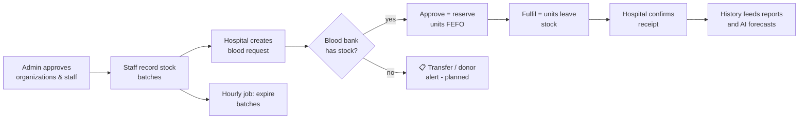

# BLOODFLOW — COMPLETE PROJECT MASTER GUIDE

### From Project Idea to Complete Technical Implementation

> **For:** Asmaa Mostafa — Team Leader and Backend .NET Developer
> **Repository:** https://github.com/asmaa-mostafa25/BloodFlow (branch `master`)
> **State described:** the code on `master` on 27 November 2026
> **Language:** English, with a short **Egyptian Arabic** explanation (🇪🇬) for every important idea.

This guide is the main entry point. Part 1 (the project) and Part 14 (the final reference) are in this file. Parts 2–13 are in `docs/guide/` so each file stays readable.

**How to read status labels in this guide**

| Label | Meaning |
|---|---|
| ✅ **Implemented** | The code exists on `master`, builds, and is covered by CI. |
| 🟡 **Partially implemented** | Some code exists, but a piece is missing or it can't be used yet. |
| 📋 **Planned** | Designed in Phase 1/Phase 2 documents only. **No code yet.** |

Every statement was checked against the repository. If something is planned, it is labelled 📋 — never described as if it works.

---

## Table of contents

| Part | File | Topic |
|---|---|---|
| 1 | this file | Understanding the project |
| 2 | [docs/guide/02-technologies.md](docs/guide/02-technologies.md) | Every technology and tool |
| 3 | [docs/guide/03-architecture.md](docs/guide/03-architecture.md) | Architecture, layers, DI, startup |
| 4 | [docs/guide/04-database.md](docs/guide/04-database.md) | Database from basics to our implementation, ERD |
| 5 | [docs/guide/05-authentication.md](docs/guide/05-authentication.md) | Identity, JWT, roles, login step by step |
| 6 | [docs/guide/06-code-walkthrough.md](docs/guide/06-code-walkthrough.md) | The code file by file |
| 7 | [docs/guide/07-api-and-http.md](docs/guide/07-api-and-http.md) | HTTP/REST basics + every endpoint |
| 8 | [docs/guide/08-workflows.md](docs/guide/08-workflows.md) | Business workflows with sequence diagrams |
| 9 | [docs/guide/09-engineering-concepts.md](docs/guide/09-engineering-concepts.md) | SOLID and other concepts in our code |
| 10 | [docs/guide/10-run-and-maintain.md](docs/guide/10-run-and-maintain.md) | Run, troubleshoot, add features, Git |
| 11 | [docs/guide/11-security-and-quality-review.md](docs/guide/11-security-and-quality-review.md) | Security and code-quality review |
| 12 | [docs/guide/12-learning-roadmap.md](docs/guide/12-learning-roadmap.md) | Your personal learning roadmap |
| 13 | [docs/guide/13-interview-preparation.md](docs/guide/13-interview-preparation.md) | 100 questions with answers + presentation tips |
| 14 | this file | Final project reference + glossary (Arabic) |

Shorter companion documents already in the repo: `README.md`, `ARCHITECTURE.md`, `DATABASE_DOCUMENTATION.md`, `API_DOCUMENTATION.md`, `SETUP_GUIDE.md`, `PROJECT_STATUS.md`, `LEARNING_GUIDE.md`, `CLAUDE.md`, and the Arabic PDF reports in `docs/reports/`.

---

# PART 1 — Understanding the Project

## 1.1 What is BloodFlow?

BloodFlow is a **web platform that connects hospitals and blood banks** so blood can be found, reserved and delivered quickly, and so blood is not wasted by expiring on a shelf. This repository is its **backend**: an ASP.NET Core Web API with a SQL Server database. The frontend (web UI), UI/UX design and the AI forecasting service are built by other team members and talk to this API.

> 🇪🇬 BloodFlow نظام بيربط المستشفيات وبنوك الدم ببعض. المستشفى اللي محتاجة دم تطلبه، وبنك الدم اللي عنده يحجزه ويبعته، والنظام بيتابع كل كيس دم وتاريخ انتهائه عشان مايترميش. احنا هنا بنتكلم عن الـ Backend: الـ API والداتابيز.

## 1.2 What problem does it solve?

| Problem today | What BloodFlow does |
|---|---|
| A hospital needs blood urgently and staff phone blood banks one by one. | Hospital creates a request once; it appears on a **board** for blood banks in the same governorate, emergencies first. |
| Nobody sees the full picture of stock across organizations. | Every organization records stock per **batch**; each batch has quantities and an expiry date. |
| Blood expires unused in one place while another place is short. | **FEFO** (first-expiring-first-out) reservations use the oldest-expiring units first; an hourly job marks expired batches; the AI service forecasts shortages and waste. |
| Two banks promise the same units / one unit is promised twice. | Reservations are enforced by the database (one live reservation per request, `OnHand ≥ Reserved`, optimistic concurrency). |
| No record of who did what. | Every change writes an **audit log** row and stock changes write an append-only **ledger**. |

> 🇪🇬 المشكلة مش إن الدم مش موجود، المشكلة إن محدش شايف مين عنده إيه، ومين محتاج إيه، وإيه اللي قرب يخلص. BloodFlow بيحل ده.

## 1.3 Why is this project needed?
Blood has a short shelf life (BloodFlow's default is **35 days**, a configurable assumption), cannot be manufactured, and in emergencies minutes matter. A shared, reliable system reduces waste, speeds up emergency responses and creates accountability (audit trail). It is also a strong graduation project because it combines real business rules, data integrity, security and AI.

## 1.4 Who are its users?

Five roles are defined in Phase 1 and seeded as Identity roles (`Application/Common/Roles.cs`):

| Role | Arabic | Who | Status in code |
|---|---|---|---|
| `SystemAdmin` | مسؤول النظام | Runs the platform | ✅ Implemented |
| `HospitalStaff` | موظف المستشفى | Requests blood, confirms receipt, manages own stock | ✅ Implemented |
| `BloodBankStaff` | موظف بنك الدم | Manages stock, approves and fulfils requests | ✅ Implemented |
| `Donor` | المتبرع | Donates blood, receives alerts, earns points | 📋 Planned (role seeded, no endpoints) |
| `Recipient` | المتلقي | Patient or representative requesting blood | 📋 Planned (role seeded, no endpoints) |

## 1.5 Main objectives
1. Real-time visibility of blood stock per organization and blood group. ✅
2. Fast, safe request handling with emergencies prioritised. ✅
3. Minimise waste with FEFO and expiry tracking. ✅ (+ AI forecasts ✅ via gateway)
4. Full accountability: audit log, ledger, status history. ✅
5. Engage donors to cover shortages. 📋
6. Redistribute stock between organizations before it expires. 📋

## 1.6 The complete system workflow



What exists today (✅): admin approval → stock → request → approve/reserve → fulfil → receive, the hourly expiry job, audit/ledger/history, and the AI gateway. What is 📋 planned: transfers, donor notifications, recipient requests, notifications in general.

> 🇪🇬 الأدمن يوافق على المؤسسات والموظفين ← الموظفين يسجلوا المخزون ← المستشفى تطلب ← بنك الدم يحجز ويبعت ← المستشفى تأكد الاستلام. ولو مفيش مخزون، التحويل والإشعارات لسه متخططين ومش معمولين.

## 1.7 Every role and its permissions (as implemented)

| Action | SystemAdmin | HospitalStaff | BloodBankStaff | Anonymous |
|---|:-:|:-:|:-:|:-:|
| Login, register as staff, lookups | ✅ | ✅ | ✅ | ✅ |
| Approve/reject/deactivate staff | ✅ | | | |
| Create/update/deactivate organizations | ✅ | | | |
| Edit system settings | ✅ | | | |
| Read audit log, any organization's stock summary | ✅ | | | |
| Record/adjust **own** organization's stock | | ✅ | ✅ | |
| Create a blood request (own hospital) | | ✅ | | |
| See the board, approve (reserve), fulfil, reallocate | | ✅¹ | ✅ | |
| Receive (destination hospital or creator) | | ✅ | | |
| Reject a pending request | | ✅ (destination) | ✅ (any) | |
| Cancel a request | ✅ (Pending only) | ✅ (party) | ✅ (executor) | |
| Review emergency overrides, monitor flagged requests | ✅ | | | |
| AI endpoints (forecast, shortage, …) | ✅ | ✅ | ✅ | `health` only |
| Retrain AI models | ✅ | | | |

¹ A hospital with surplus can approve **another** hospital's request (Phase 1: "blood bank or hospital with surplus"); it can never approve its own.

Details with every rule are in Part 7 and Part 8.

## 1.8 Business and functional requirements

**Business requirements (Phase 1 workflows):**
- BR1 Only approved staff of active organizations can work. ✅
- BR2 Stock is tracked per batch; `Available = OnHand − Reserved`; expired units are excluded. ✅
- BR3 Every stock movement is recorded (Reserve, Release, Deduct, Intake, Adjust). ✅
- BR4 A request must be verified before blood leaves, except an emergency with a recorded override reason. ✅ (override path 🟡 — see 1.10)
- BR5 No partial approvals; FEFO allocation. ✅
- BR6 No double allocation; conflicts return 409. ✅
- BR7 Every state change is audited and status history is kept. ✅
- BR8 Patient privacy: name visible only to the destination hospital and the requester; anonymized after a retention period. ✅
- BR9 Donors notified for emergencies/shortages; points and badges. 📋
- BR10 Transfers between organizations. 📋

**Functional requirements (implemented endpoints):** authentication and staff registration; admin management of staff, organizations, settings, audit logs, inventory reports, request monitoring and override review; inventory intake, adjustment, batches, ledger and summary; the full request lifecycle; AI gateway endpoints. The full list (53 endpoints) is in Part 7.

## 1.9 Non-functional requirements

| Requirement | How it is met in code |
|---|---|
| **Security** | JWT with signature/issuer/audience/expiry validation; account & organization status re-checked on every request; Identity password hashing; lockout after 5 failures; organization taken from the token; secrets outside Git. |
| **Data integrity** | CHECK constraints, composite foreign keys, filtered unique indexes, `rowversion` concurrency, one `SaveChanges` per action. |
| **Auditability** | `AuditLogs`, `InventoryTransactions` (append-only), `BloodRequestStatusHistory`. |
| **Reliability** | Idempotent creates (`clientRequestId`), idempotent hourly job, global exception handler. |
| **Maintainability** | Clean Architecture, thin controllers, pure rule classes, conventions in `CLAUDE.md`. |
| **Testability** | 83 unit tests on pure rules; `IClock` abstraction; CI on every push. |
| **Usability for the frontend** | Consistent ProblemDetails with stable `code`; enums as text; paging; Swagger. |
| **Privacy** | Patient name rules and anonymization. |
| **Performance** | Indexes for every main query; projections (`Select`) instead of loading whole entities; paging with max 100. |

## 1.10 Scope and limitations

**In scope and done:** Slices 1–3, AI gateway, deployment.
**Limitations (true today):**
- Only **whole blood**, one blood product per request (Phase 1 assumption).
- 🟡 The **emergency override** is coded but cannot happen yet: all requests are created by hospital staff and are verified at creation, so an *unverified* emergency doesn't exist until patient requests (Slice 5) are built. The supervisor also asked that **each hospital decide by policy** whether it allows the override — not implemented yet.
- No notifications (escalation is only a flag in lists).
- No transfers, donors or recipients.
- Only unit tests (no integration tests).
- AI endpoints require the separate Python AI service; it is not configured on the hosted server.
- Free hosting (MonsterASP): sleeps when idle, 1 GB database.

---

# PART 14 — Final Project Reference

## 14.1 Technology stack (from the `.csproj` files)

| Area | Technology | Version |
|---|---|---|
| Language / runtime | C#, .NET | `net10.0`, SDK pinned `10.0.100` in `global.json` |
| Web framework | ASP.NET Core Web API (controllers) | 10 |
| ORM | Entity Framework Core + SqlServer provider + Tools/Design | 10.0.14 |
| Database | Microsoft SQL Server (collation `Arabic_100_CI_AI`) | Express/Developer locally; MonsterASP in production |
| Identity | ASP.NET Core Identity (EF Core stores) | 10.0.14 |
| Auth | JWT Bearer (`Microsoft.AspNetCore.Authentication.JwtBearer`) | 10.0.14 |
| API docs | `Microsoft.AspNetCore.OpenApi` + `Swashbuckle.AspNetCore.SwaggerUI` | 10.0.11 / 10.2.1 |
| Crypto dependency pin | `System.Security.Cryptography.Pkcs` | 10.0.14 |
| Tests | xUnit, Microsoft.NET.Test.Sdk, xunit.runner.visualstudio, coverlet.collector | 2.9.3 / 17.14.1 / 3.1.4 / 6.0.4 |
| CI | GitHub Actions (`.github/workflows/ci.yml`) | — |
| Hosting | MonsterASP.NET (IIS, Web Deploy) | free plan |
| External service | BloodFlow AI (Python FastAPI, separate repo/team) | — |

## 14.2 Architecture summary
Clean Architecture with 4 projects + tests. Dependencies point inwards: `Api → Infrastructure → Application → Domain`, and `Api → Application`. Controllers call **interfaces** from Application; Infrastructure implements them with EF Core. Expected failures are returned as `Result`/`Error` and converted to ProblemDetails. One `SaveChanges` per action saves the change, its ledger rows, history and audit together. Details: Part 3.

## 14.3 Database summary
20 tables (13 BloodFlow + 7 Identity), 6 migrations, 1 SQL sequence (`BloodRequestNumbers`), 38 CHECK constraints, composite foreign keys for organization/blood-group consistency, `rowversion` on 6 mutable tables, enums stored as text, UTC timestamps. Seed: 27 governorates, 8 blood groups (migrations), 5 roles + first admin + 9 system settings (startup). Details: Part 4 and `DATABASE_DOCUMENTATION.md`.

## 14.4 Implemented modules ✅
| Module | Main files |
|---|---|
| Auth (login, staff registration, JWT) | `Infrastructure/Authentication/*`, `Api/Controllers/AuthController.cs` |
| Admin: staff | `Infrastructure/Services/StaffAdminService.cs`, `Api/Controllers/Admin/StaffController.cs` |
| Admin: organizations | `OrganizationService.cs`, `Admin/OrganizationsController.cs` |
| Admin: settings | `SystemSettingService.cs`, `Application/Settings/SettingValueValidator.cs`, `Admin/SettingsController.cs` |
| Admin: audit logs | `AuditLogService.cs`, `Admin/AuditLogsController.cs` |
| Lookups | `LookupService.cs`, `LookupsController.cs` |
| Inventory | `Infrastructure/Inventory/*`, `Application/Inventory/*`, `InventoryController.cs`, `Admin/InventoryReportsController.cs` |
| Requests & reservations | `Infrastructure/Requests/*`, `Application/Requests/*`, `RequestsController.cs`, `Admin/RequestsMonitorController.cs` |
| Hourly maintenance | `Infrastructure/Jobs/MaintenanceBackgroundService.cs` |
| AI gateway | `Infrastructure/Ai/*`, `Application/Ai/*`, `AiController.cs` |
| Deployment config | `Program.cs` (CORS, Swagger flag), `appsettings.Production.example.json` |

## 14.5 Incomplete modules
| Module | State |
|---|---|
| Emergency override in practice; per-hospital override policy | 🟡 coded / 📋 policy |
| `verify` endpoint (for patient requests) | 🟡 works, no unverified requests exist yet |
| Donors (profile, donations, eligibility, points, badges) | 📋 |
| Recipients (patient/representative requests) | 📋 |
| Transfers, shortage alerts | 📋 |
| Notifications (email/in-app) | 📋 |
| Integration tests | 📋 |
| Email confirmation, password reset, refresh tokens, rate limiting | 📋 |

## 14.6 Known issues (from `PROJECT_STATUS.md` and the review in Part 11)
1. Server JWT key and DB password were pasted in chat → rotate the JWT key and admin password (DB password already changed).
2. Swagger enabled on the public server (by config) → disable after the demo.
3. Merged branches on GitHub not deleted.
4. Any BloodBankStaff can reject any pending request (follows Phase 1; may be too broad).
5. Emergency override review has no concurrency token.
6. Duplicate request check compares patient name text.
7. Hourly job runs inside the API (duplicated work if scaled to many instances).
8. CI vulnerable-package step prints but does not fail.
9. Visual Studio 2022 is not officially supported for .NET 10 → use VS 2026 or the CLI.
10. `Jwt:Key` length is not validated at startup (only "not empty"); a short key makes token signing fail at login.
11. Staff self-registration is open to anyone (accounts stay Pending until approved).

## 14.7 Important GitHub paths
| Path | What |
|---|---|
| `src/BloodFlow.Api/Program.cs` | Startup and middleware |
| `src/BloodFlow.Infrastructure/DependencyInjection.cs` | All service registrations, JWT validation |
| `src/BloodFlow.Infrastructure/Persistence/AppDbContext.cs` | DbContext |
| `src/BloodFlow.Infrastructure/Persistence/Configurations/` | Fluent API per table |
| `src/BloodFlow.Infrastructure/Persistence/Migrations/` | Migrations + model snapshot |
| `src/BloodFlow.Application/Requests/RequestRules.cs` | FEFO, transitions, flags |
| `src/BloodFlow.Infrastructure/Requests/RequestService.cs` | Request lifecycle |
| `src/BloodFlow.Infrastructure/Requests/ReservationLedger.cs` | The only place that moves reserved stock |
| `src/BloodFlow.Application/Inventory/InventoryRules.cs` | Intake/adjust rules |
| `src/BloodFlow.Api/BloodFlow.Api.http` | Manual test requests |
| `tests/BloodFlow.Tests/` | Unit tests |
| `.github/workflows/ci.yml` | CI |
| `docs/reports/` | Arabic slice reports + defense guide |

## 14.8 Important commands
```bash
git clone https://github.com/asmaa-mostafa25/BloodFlow.git
dotnet tool install --global dotnet-ef
dotnet user-secrets set "Key" "value"            # run inside src/BloodFlow.Api
dotnet user-secrets list
dotnet build
dotnet test
dotnet run --project src/BloodFlow.Api
dotnet ef migrations add <Name> --project src/BloodFlow.Infrastructure --startup-project src/BloodFlow.Api
dotnet ef database update --project src/BloodFlow.Infrastructure --startup-project src/BloodFlow.Api
dotnet ef migrations list --project src/BloodFlow.Infrastructure --startup-project src/BloodFlow.Api
dotnet publish src/BloodFlow.Api -c Release -o publish
git checkout -b feature/<name>   →   git add .   →   git commit -m "..."   →   git push -u origin feature/<name>
```

## 14.9 Glossary (with simple Egyptian Arabic)

| Term | English | 🇪🇬 بالعامية |
|---|---|---|
| API | A set of URLs other programs call to use our system | الباب اللي الفرونت والموبايل بيكلموا بيه السيستم |
| REST | A style of API using URLs + HTTP methods for resources | طريقة منظمة: كل حاجة ليها لينك، و GET يجيب و POST يضيف |
| Endpoint | One URL + method, e.g. `POST /api/auth/login` | عنوان واحد بيعمل حاجة واحدة |
| HTTP status code | Number telling the result (200, 404, …) | رقم بيقول الطلب نجح ولا فشل وليه |
| JSON | Text format for data | شكل البيانات اللي بتتبعت وبترجع |
| DTO | Class defining what the API receives/returns | الشكل اللي بيدخل ويطلع من الـ API، مش الجدول نفسه |
| Entity | Class mapped to a table | كلاس بيمثل جدول في الداتابيز |
| ORM / EF Core | Library mapping classes to tables | بيترجم الكود C# لـ SQL بدالك |
| DbContext | EF's session with the database | الجلسة اللي بتتابع التغييرات وتحفظها مرة واحدة |
| DbSet | A table inside the DbContext | الجدول جوه الـ DbContext |
| Migration | A versioned change to the database schema | ملف بيقول الداتابيز اتغيرت إزاي، ونقدر نطبقه أو نرجعه |
| Fluent API | Configuring the model in code (`builder.Property(...)`) | بنوصف الجداول والقيود بالكود |
| Primary key | Unique id of a row | الرقم اللي بيميز كل صف |
| Foreign key | Column pointing to another table's key | عمود بيربط الصف بصف في جدول تاني |
| Composite key | Key made of several columns | مفتاح من أكتر من عمود |
| Index | Structure that makes searches fast | زي الفهرس في الكتاب |
| Unique / filtered index | No duplicates (for all rows / for some rows) | ممنوع التكرار، أو ممنوع بس في حالة معينة |
| CHECK constraint | Rule the database enforces on values | شرط الداتابيز نفسها بتفرضه |
| Normalization | Organizing tables to avoid duplicated data | كل معلومة في مكان واحد بس |
| Transaction | All-or-nothing group of changes | يا كله يتحفظ يا ولا حاجة |
| Concurrency / RowVersion | Detecting two edits at the same time | لو اتنين عدّلوا نفس الحاجة في نفس اللحظة، التاني ياخد 409 |
| Idempotency | Repeating a request has no extra effect | لو دوست مرتين، مايحصلش حاجة زيادة |
| Authentication | Proving who you are | انت مين؟ |
| Authorization | Checking what you may do | مسموحلك تعمل إيه؟ |
| Identity | ASP.NET's user/password/role system | السيستم الجاهز للمستخدمين والباسوردات والأدوار |
| Hashing | One-way transformation of a password | الباسورد بيتخزن متشفر بطريقة ماترجعش |
| JWT | Signed token with user info | كارنيه رقمي موقّع فيه مين انت ودورك |
| Claim | One fact inside the token | معلومة جوه الكارنيه زي الدور ورقم المؤسسة |
| Role | A group of permissions | الدور: أدمن، موظف مستشفى، موظف بنك دم |
| Middleware | Steps every request passes through | محطات كل طلب بيعدي عليها بالترتيب |
| Dependency Injection | The framework gives a class what it needs | الكلاس مابيعملش new، الحاجات بتتحطله جاهزة |
| Interface | A contract of methods without implementation | عقد: "فيه حد هيعمل كذا" |
| Clean Architecture | Layers with rules in the centre | القواعد في النص ومش معتمدة على التكنولوجيا |
| Result pattern | Returning success or an error instead of throwing | الميثود ترجع "نجح ومعاه البيانات" أو "فشل ومعاه السبب" |
| ProblemDetails | Standard JSON error format | شكل موحد لرسايل الخطأ |
| Async/await | Non-blocking waiting for I/O | السيرفر مايقعدش مستني الداتابيز، يخدم غيره |
| LINQ | C# query syntax (`Where`, `Select`) | طريقة نكتب بيها استعلامات بالـ C# |
| Projection | `Select` into a smaller object | نجيب الأعمدة اللي محتاجينها بس |
| FEFO | First Expiring, First Out | اللي هيخلص الأول يطلع الأول |
| Batch | Group of units with one expiry date | دفعة أكياس ليها تاريخ انتهاء واحد |
| Ledger | Append-only record of stock moves | دفتر حركة المخزون، بنضيف فيه بس ومابنعدلش |
| Reservation | Units held for a request | أكياس محجوزة لطلب معين |
| Audit log | Record of who did what | سجل مين عمل إيه وإمتى |
| CORS | Browser rule for cross-site API calls | المتصفح مايسمحش لموقع يكلّم API على دومين تاني إلا لو الـ API سمحله |
| Swagger / OpenAPI | Interactive API documentation | صفحة فيها كل الـ endpoints وتجربهم منها |
| CI | Automatic build and test on every push | GitHub بيعمل build وtest لوحده مع كل push |
| User Secrets | Developer-machine secret storage | مكان على جهازك للأسرار بره المشروع |

## 14.10 Prioritized remaining tasks

| Priority | Task |
|---|---|
| **P0** | Rotate server `Jwt:Key` and admin password; publish. Delete merged branches. Add the frontend URLs to `Cors:AllowedOrigins`. Study Parts 1, 3, 5, 6 until you can explain them. |
| **P1** | Per-hospital emergency override policy (supervisor). Validate `Jwt:Key` length at startup. Slice 4 Donors (write it yourself). Integration tests (Testcontainers). |
| **P2** | Slice 5 Recipients. Slice 6 Transfers + shortage alerts. Slice 7 Notifications. Host the AI service and configure it on the server. |
| **P3** | Disable Swagger in production after the demo; rate limiting on login/register; password reset; Docker; structured logging. |
