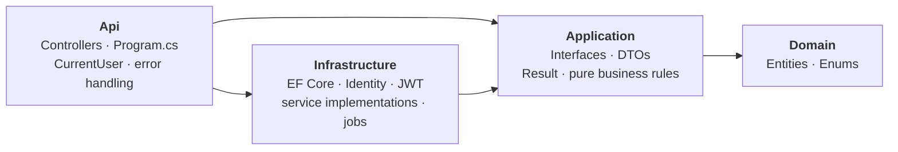
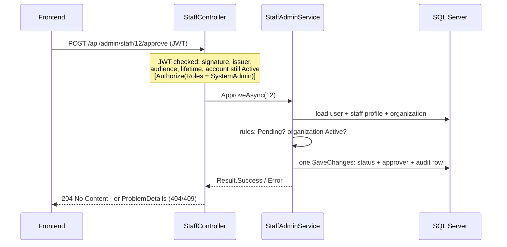

# 🩸 BloodFlow — Backend API

**Smart Blood Inventory & Redistribution System**

[](https://github.com/asmaa-mostafa25/BloodFlow/actions/workflows/ci.yml)


BloodFlow connects **hospitals, blood banks, donors and recipients** across Egypt's 27 governorates. It tracks blood stock per batch, handles normal and emergency blood requests, reserves units safely, and moves blood between organizations before it expires.

> 🎓 Graduation project. This repository is the **ASP.NET Core Web API**. The frontend, UI/UX and AI work live with their teams.

---

## 📍 Status

| Slice | Scope | State |
|---|---|---|
| Foundation | Clean Architecture, reference data, Identity, JWT login | ✅ Done |
| **1 · System Admin** | Staff registration & approval, organizations, settings, audit log | ✅ Done — PR [#1](https://github.com/asmaa-mostafa25/BloodFlow/pull/1) |
| **2 · Blood Bank Staff** | Batches, stock ledger, intake, adjustments, expiry job | ✅ Done — PR [#2](https://github.com/asmaa-mostafa25/BloodFlow/pull/2) |
| **3 · Hospital Staff** | Requests, FEFO reservations, fulfilment, receipt, emergencies | ✅ Done — PR [#4](https://github.com/asmaa-mostafa25/BloodFlow/pull/4) |
| **AI integration** | Backend ↔ AI service (forecast, shortage, expiry, substitutions, retrain) | ✅ Done — PR [#3](https://github.com/asmaa-mostafa25/BloodFlow/pull/3) |
| 4 · Donors | Donor profile, donations & verification, points & badges | ⏳ Next |
| 5 · Recipients | Recipient requests and tracking | ⏳ |
| 6 · Transfers | Moving stock between organizations | ⏳ |
| 7 · Notifications | Email & in-app alerts, escalation | ⏳ |

Each slice goes through: design review → Domain → EF configuration + migration → services → API + Swagger → tests → CI.

---

## 📑 Contents

- [Tech stack](#️-tech-stack)
- [Architecture](#️-architecture)
- [Getting started](#-getting-started)
- [Configuration](#️-configuration)
- [Authentication & roles](#-authentication--roles)
- [API reference](#-api-reference)
- [API conventions](#-api-conventions)
- [Business rules](#-business-rules-implemented)
- [Database](#️-database)
- [Reference data](#-reference-data)
- [Testing & CI](#-testing--ci)
- [Git workflow](#-git-workflow)
- [Documentation](#-documentation)
- [Team](#-team)

---

## 🛠️ Tech stack

| Area | Technology |
|---|---|
| Framework | .NET 10, ASP.NET Core Web API (controllers) |
| Data | Entity Framework Core 10 (Code-First, Migrations), SQL Server, collation `Arabic_100_CI_AI` |
| Identity | ASP.NET Core Identity (`int` keys, `AddIdentityCore`) |
| Auth | JWT Bearer (HMAC-SHA256, 60-minute tokens) |
| API docs | Built-in OpenAPI + Swagger UI (Development only) |
| Errors | ProblemDetails (RFC 9457) with a stable `code` |
| Tests | xUnit |
| CI | GitHub Actions: build, test, vulnerable-package check |

---

## 🏗️ Architecture

A pragmatic **Clean Architecture** with four projects:



- **Domain** depends on nothing (no NuGet packages).
- **Application** defines *what* the system does (`IAuthService`, `IInventoryService`, …) and the pure rules (`InventoryRules`, `SettingValueValidator`).
- **Infrastructure** defines *how* (EF Core, Identity, JWT). Each layer registers its own services; the API only calls `AddInfrastructure(...)`.
- **Api** knows the interfaces, not the database. Controllers return `Result` → HTTP via one helper.

### Request flow (example: approve a staff member)



### Project structure

```
src/
├── BloodFlow.Domain/
│   ├── Entities/        Governorate · BloodGroup · Organization · StaffProfile
│   │                    SystemSetting · AuditLog · BloodBatch · InventoryTransaction
│   └── Enums/
├── BloodFlow.Application/
│   ├── Common/          Result · Error · PagedResult · Roles · ICurrentUser · IClock · claim/audit/setting names
│   ├── Auth/  Staff/  Organizations/  Lookups/  Settings/  Audit/  Inventory/
│   │                    one folder per feature: interfaces + DTOs (+ pure rules)
├── BloodFlow.Infrastructure/
│   ├── DependencyInjection.cs   ← AddInfrastructure()
│   ├── Persistence/     AppDbContext · Configurations/ · Migrations/ · Seed/
│   ├── Identity/        ApplicationUser · IdentitySeeder
│   ├── Authentication/  JwtSettings · JwtTokenGenerator · AuthService
│   ├── Services/        StaffAdmin · Organization · SystemSetting · Lookup · AuditLog
│   ├── Inventory/       InventoryService · summary · BatchExpiryService (+ background job)
│   └── Common/          AuditLogger · SystemClock · SettingsReader · RowVersionConverter
└── BloodFlow.Api/
    ├── Program.cs
    ├── Controllers/     Auth · Lookups · Inventory · Admin/ (Staff · Organizations · Settings · AuditLogs · InventoryReports)
    ├── Common/          CurrentUser · ResultExtensions · GlobalExceptionHandler
    └── OpenApi/         Bearer security scheme for Swagger
tests/
└── BloodFlow.Tests/     unit tests for the pure rules
```

---

## 🚀 Getting started

### 1. Prerequisites

- [.NET 10 SDK](https://dotnet.microsoft.com/download)
- SQL Server (Express, Developer or LocalDB)
- EF Core CLI: `dotnet tool install --global dotnet-ef --version 10.0.14`

### 2. Clone

```bash
git clone https://github.com/asmaa-mostafa25/BloodFlow.git
cd BloodFlow
```

### 3. Secrets (User Secrets — never in the repository)

From `src/BloodFlow.Api`:

```bash
cd src/BloodFlow.Api

dotnet user-secrets set "ConnectionStrings:DefaultConnection" "Server=.\SQLEXPRESS;Database=BloodFlowDb;Trusted_Connection=True;TrustServerCertificate=True"
dotnet user-secrets set "Jwt:Key" "<random value, at least 32 characters>"
dotnet user-secrets set "AdminSeed:Email" "admin@bloodflow.local"
dotnet user-secrets set "AdminSeed:Password" "<8+ chars with upper, lower and a digit>"

cd ../..
```

Generate a strong `Jwt:Key` in PowerShell:

```powershell
$b = New-Object byte[] 64; [Security.Cryptography.RandomNumberGenerator]::Create().GetBytes($b); [Convert]::ToBase64String($b)
```

> Replace `.\SQLEXPRESS` with your instance (e.g. `(localdb)\MSSQLLocalDB`). The API refuses to start if a required secret is missing and says which one.

### 4. Create the database

```bash
dotnet ef database update --project src/BloodFlow.Infrastructure --startup-project src/BloodFlow.Api
```

> Visual Studio **Package Manager Console**: set `BloodFlow.Api` as Startup Project, choose `BloodFlow.Infrastructure` as Default project, run `Update-Database`.

### 5. Run

```bash
dotnet run --project src/BloodFlow.Api --launch-profile https
```

Open **Swagger UI**: <https://localhost:7244/swagger>

1. `POST /api/auth/login` with the admin email/password from step 3.
2. Copy `token` → click **Authorize** → paste it.

### What is seeded automatically

| When | What |
|---|---|
| `database update` (migration `HasData`) | 27 governorates, 8 blood groups |
| Every API start (only if missing) | 5 roles, the first System Admin, 9 default system settings |

### 6. Connect the AI service

The backend talks to the BloodFlow AI service (FastAPI) server-to-server. The frontend never calls the AI directly: it calls `/api/ai/*` with its JWT, and the backend adds the AI key.

1. Start the AI server (in the AI folder): `python -m uvicorn api:app --host 0.0.0.0 --port 8000`, and wait for `Application startup complete`.
2. Give the backend the same key the AI server uses (`BLOODFLOW_API_KEY`, default `bloodflow-secret` for testing only):
   ```bash
   cd src/BloodFlow.Api
   dotnet user-secrets set "BloodFlowAi:ApiKey" "bloodflow-secret"
   ```
3. If the AI runs on another machine, change `BloodFlowAi:BaseUrl` in `appsettings.json` (e.g. `http://192.168.1.10:8000`).

| Backend endpoint | AI endpoint | Who |
|---|---|---|
| `GET /api/ai/health` | `GET /health` | anyone |
| `GET /api/ai/stock` | `GET /stock` | staff |
| `GET /api/ai/forecast` | `GET /forecast/all` | staff |
| `POST /api/ai/shortage` | `POST /predict/shortage` | staff |
| `POST /api/ai/expiry` | `POST /predict/expiry` | staff |
| `POST /api/ai/substitutions` | `POST /substitutions` | staff |
| `POST /api/ai/demand` | `POST /predict/demand` | staff |
| `POST /api/ai/retrain` | `POST /retrain` | SystemAdmin |

Staff = SystemAdmin, HospitalStaff, BloodBankStaff. Responses are camelCase. Errors come back as ProblemDetails: `400` bad input (the AI's message is in `detail`), `409` a retrain is already running, `502` wrong AI key, `503` AI server down or still starting. `retrain` defaults to `mode: "append"`.

---

## ⚙️ Configuration

| Key | Where | Default | Notes |
|---|---|---|---|
| `ConnectionStrings:DefaultConnection` | User Secrets | — | Required |
| `Jwt:Key` | User Secrets | — | Required, ≥ 32 characters |
| `Jwt:Issuer` / `Jwt:Audience` | `appsettings.json` | `BloodFlow.Api` / `BloodFlow.Client` | |
| `Jwt:ExpiryMinutes` | `appsettings.json` | `60` | Short on purpose |
| `AdminSeed:Email` / `AdminSeed:Password` | User Secrets | — | Required, used to create the first admin |
| `BloodFlowAi:ApiKey` | User Secrets | — | Same key as the AI server. Missing → AI calls return `502` |
| `BloodFlowAi:BaseUrl` | `appsettings.json` | `http://127.0.0.1:8000` | Where the AI service runs |
| `App:TimeZone` | `appsettings.json` | `Africa/Cairo` | Decides "today" for expiry dates |

On a server (e.g. MonsterASP) use **environment variables** instead of User Secrets: `ConnectionStrings__DefaultConnection`, `Jwt__Key`, `AdminSeed__Email`, `AdminSeed__Password`.

### System settings (editable by the admin at runtime)

| Key | Default | Medical* |
|---|---|---|
| `Donation.MinimumDonorAgeYears` | 18 | ✔ |
| `Donation.IntervalDays` | 56 | ✔ |
| `Inventory.DefaultShelfLifeDays` | 35 | ✔ |
| `Requests.MaxUnitsPerRequest` | 10 | ✔ |
| `Inventory.NearExpiryAlertDays` | 7 | |
| `Requests.EmergencyEscalationMinutes` | 30 | |
| `Requests.ReceiptConfirmationHours` | 48 | |
| `Requests.DuplicateWindowHours` | 24 | |
| `Privacy.PatientNameRetentionMonths` | 12 | |

\* Medical values are **assumptions awaiting the supervisor's confirmation**. Changing them requires an `approvalReference`.

---

## 🔐 Authentication & roles

| Role | Constant | Gets in by |
|---|---|---|
| System Admin | `SystemAdmin` | Seeded from `AdminSeed:*` |
| Hospital Staff | `HospitalStaff` | Self-registration → admin approval |
| Blood Bank Staff | `BloodBankStaff` | Self-registration → admin approval |
| Donor | `Donor` | Slice 4 |
| Recipient | `Recipient` | Slice 5 |

**Login rules**

- Wrong email or password → `401` with the **same message** for both (no user enumeration).
- 5 wrong passwords → locked for 15 minutes.
- After a correct password, `Pending` / `Rejected` / `Deactivated` accounts and staff of a deactivated organization get `403` with the reason.

**Token claims:** `sub` (user id) · `email` · `name` · `role` · `org_id` (staff only) · `jti`

**Every request** re-checks that the account (and the staff member's organization) is still active, so deactivation works immediately instead of waiting for the token to expire.

---

## 🔌 API reference

Full, live documentation is in Swagger. Summary:

### Public

| Method | Route | What |
|---|---|---|
| POST | `/api/auth/login` | Sign in → `{ token, expiresAtUtc, user }` |
| POST | `/api/auth/register/staff` | Staff self-registration → account `Pending` |
| GET | `/api/lookups/governorates` | Dropdown data |
| GET | `/api/lookups/blood-groups` | Dropdown data |
| GET | `/api/lookups/organizations?type=&governorateId=` | Active organizations only |

### System Admin — `/api/admin/...`

| Method | Route | What |
|---|---|---|
| GET | `/staff?status=Pending` | Approval queue (oldest first) — also filters by organization, kind, search |
| GET | `/staff/{userId}` | Staff details |
| POST | `/staff/{userId}/approve` | `Pending → Active` (organization must be active) |
| POST | `/staff/{userId}/reject` | `Pending → Rejected` — body `{ reason }` |
| POST | `/staff/{userId}/deactivate` | `Active → Deactivated` — body `{ reason }` |
| POST | `/staff/{userId}/reactivate` | `Deactivated → Active` |
| GET · POST | `/organizations` | List · create a hospital or blood bank |
| GET · PUT | `/organizations/{id}` | Details · update (send back `rowVersion`) |
| POST | `/organizations/{id}/deactivate` · `/activate` | Change status — deactivate needs `{ reason }` |
| GET | `/settings` · `/settings/{key}` | System settings |
| PUT | `/settings/{key}` | `{ value, approvalReference?, rowVersion }` |
| GET | `/audit-logs?entityType=&entityId=&actorUserId=&action=&fromUtc=&toUtc=` | Read-only audit trail |
| GET | `/inventory/organizations/{id}/summary` | Read-only stock of one organization |

### Staff (Hospital & Blood Bank) — `/api/inventory/...`

Staff always work on **their own organization** (from `org_id`), never an id sent in the request.

| Method | Route | What |
|---|---|---|
| GET | `/summary` | Per blood group: on hand, reserved, available, near expiry, expired |
| GET | `/batches?bloodGroupId=&status=&expiringWithinDays=&hideEmpty=` | Batches, earliest expiry first (FEFO) |
| GET | `/batches/{id}` | One batch |
| POST | `/batches` | Manual intake `{ bloodGroupId, quantity, collectionDate, expiryDate?, clientRequestId? }` |
| POST | `/batches/{id}/adjust` | `{ quantityDelta, reasonCode, reason, clientRequestId? }` |
| GET | `/transactions?batchId=&type=&fromUtc=&toUtc=` | Stock ledger, newest first |

### Blood requests — `/api/requests/...` (Hospital & Blood Bank staff)

```
Pending ──approve──► Approved ──fulfil──► Fulfilled ──receive──► Received
   ├─reject──► Rejected   └─cancel──► Cancelled (reserved units released)
   └─cancel──► Cancelled
```

| Method | Route | Who | What |
|---|---|---|---|
| POST | `/` | Hospital | Create `{ requestType, bloodGroupId, unitsRequested, neededBy, patientFullName, clientRequestId? }` |
| GET | `/hospital?status=&type=&bloodGroupId=&onlyFlagged=` | Hospital | Requests for my hospital |
| GET | `/board?type=&bloodGroupId=&allGovernorates=` | Staff | Open requests I can fulfil — emergencies first, with my available units |
| GET | `/executing` | Staff | Requests my organization reserved |
| GET | `/{id}` · `/{id}/history` | Parties | Details (with reservation lines) · status timeline |
| POST | `/{id}/verify` | Destination hospital | Verify a request it did not create |
| POST | `/{id}/approve` | Other hospital / blood bank | Reserve **all** units now, FEFO — no partial approvals |
| POST | `/{id}/reallocate` | Executing org | Top up after a reserved batch expired |
| POST | `/{id}/fulfil` | Executing org | Units leave stock. Unverified emergency → `{ emergencyOverrideReason }` |
| POST | `/{id}/receive` | Destination hospital | Confirm arrival |
| POST | `/{id}/reject` · `/{id}/cancel` | See rules | `{ reason }` — cancelling an approved request releases its units |

Admin: `GET /api/admin/requests?onlyFlagged=true`, `POST /api/admin/requests/{id}/cancel` (pending only), `GET /api/admin/emergency-overrides`, `POST /api/admin/emergency-overrides/{id}/review`.

Ready-made requests: [`src/BloodFlow.Api/BloodFlow.Api.http`](src/BloodFlow.Api/BloodFlow.Api.http).

---

## 📏 API conventions

| Topic | Rule |
|---|---|
| **Errors** | Always ProblemDetails: `{ type, title, status, code, traceId }`. Use `code` (e.g. `Staff.InvalidStatus`), not the message text. Validation errors add `errors` per field. |
| **Status codes** | `400` invalid input · `401` not signed in / bad credentials · `403` not allowed · `404` not found (or not yours) · `409` wrong state, duplicate or concurrent change |
| **Enums** | Sent and received as text: `"Hospital"`, `"Pending"`, `"Damaged"` |
| **Times** | `…AtUtc` / `CreatedAt` are UTC. Show them in local time. |
| **Dates** | Date-only fields (`collectionDate`, `expiryDate`) use `"2026-11-20"` |
| **Paging** | `page` (from 1) and `pageSize` (default 20, max 100) → `{ items, page, pageSize, totalCount, totalPages }` |
| **Concurrency** | Editable records return a `rowVersion`. Send it back on update; `409` means someone changed it first — reload. |
| **Idempotency** | For stock operations and new requests send a new GUID `clientRequestId` per form submission; resending the same one never changes stock twice. |

---

## 📐 Business rules implemented

From the Phase 1 business workflows:

**Staff & organizations (A1, A2)**
- Staff register as `Pending`; their kind (hospital / blood bank) always equals their organization's type — enforced by a composite foreign key.
- Approval requires an active organization. Reject and deactivate need a reason. `Rejected` is final.
- An organization with active reservations or open requests cannot be deactivated. An organization's type cannot change after creation. Names are unique per governorate.
- Every status change writes an audit row **in the same database transaction**.

**Inventory (B1, H4, A3)**
- `Available = OnHand − Reserved`, counting only non-expired batches.
- Intake: quantity > 0, collected today or earlier, expiry after collection and in the future. No expiry date → collection date + shelf-life setting.
- Adjustments: `Damaged` / `Expired` only decrease, `Correction` may go either way; reason required; on-hand never below reserved. Expired batches can only be disposed of.
- The ledger is append-only. Database CHECK constraints guarantee `OnHand ≥ Reserved ≥ 0`.
- A batch is usable until the end of its expiry date (Cairo time). A background job marks it `Expired` afterwards.
- The admin can see stock but never change it.

**Requests & reservations (H1–H3, B2–B3, section 4)**
- Hospital staff create requests for their own hospital (verified at creation). Units ≤ `Requests.MaxUnitsPerRequest`; `neededBy` in the future.
- Duplicate guard: same hospital + blood group + patient with an open request inside `Requests.DuplicateWindowHours` → `409`.
- Approve reserves every unit immediately using **FEFO**; not enough usable stock → nothing is reserved. One live reservation per request (unique index), so two banks can't both win.
- Every stock move (`Reserve`, `Release`, `Deduct`) writes a ledger row linked to its reservation line. Composite foreign keys guarantee a reserved batch belongs to the same organization **and** blood group.
- Expired reserved batches are released as `Invalidated` (hourly job, and again at fulfil time); the request shows *needs reallocation*. Expired blood is never sent.
- Normal requests must be verified before approval and fulfilment. Emergencies can be reserved early and fulfilled unverified only with an override reason, which is recorded and reviewed by the admin.
- Flags: approved past `neededBy` (overdue), fulfilled but not received within `Requests.ReceiptConfirmationHours`, emergency pending longer than `Requests.EmergencyEscalationMinutes`.
- Patient names are visible only to the destination hospital and the requester, never written to the audit log, and removed after `Privacy.PatientNameRetentionMonths`.

---

## 🗄️ Database

**Tables (20):** `Governorates`, `BloodGroups`, `Organizations`, the 7 Identity tables (`AspNetUsers`, `AspNetRoles`, …), `StaffProfiles`, `SystemSettings`, `AuditLogs`, `BloodBatches`, `InventoryTransactions`, `BloodRequests`, `BloodRequestStatusHistory`, `Reservations`, `ReservationLines`, `EmergencyOverrides`.

| Migration | Adds |
|---|---|
| `InitialCreate` | Governorates, blood groups, organizations |
| `SeedReferenceData` | 27 governorates, 8 blood groups |
| `AddIdentity` | Identity tables (`int` keys) |
| `AddAdminSlice` | Account status, staff profiles, settings, audit log |
| `AddInventory` | Blood batches, inventory ledger |
| `AddRequests` | Requests, status history, reservations, emergency overrides, request-number sequence |

Conventions: statuses stored as text with CHECK constraints · all foreign keys `Restrict` (no hard deletes) · UTC `datetime2`, `date` for date-only · `rowversion` on records edited concurrently.

**Adding a migration**

```bash
dotnet ef migrations add <Name> --project src/BloodFlow.Infrastructure --startup-project src/BloodFlow.Api --output-dir Persistence/Migrations
```

Always read the generated file before `database update`.

---

## 📚 Reference data

These ids are fixed; frontend dropdowns can rely on them (or call `/api/lookups/...`).

### Blood groups

| Id | Code | | Id | Code |
|---|---|---|---|---|
| 1 | A+ | | 5 | AB+ |
| 2 | A- | | 6 | AB- |
| 3 | B+ | | 7 | O+ |
| 4 | B- | | 8 | O- |

### Governorates

| Id | Name | | Id | Name | | Id | Name |
|---|---|---|---|---|---|---|---|
| 1 | القاهرة | | 10 | الجيزة | | 19 | المنيا |
| 2 | الإسكندرية | | 11 | المنوفية | | 20 | سوهاج |
| 3 | بورسعيد | | 12 | القليوبية | | 21 | قنا |
| 4 | السويس | | 13 | البحيرة | | 22 | كفر الشيخ |
| 5 | البحر الأحمر | | 14 | الغربية | | 23 | مطروح |
| 6 | دمياط | | 15 | الأقصر | | 24 | أسوان |
| 7 | الدقهلية | | 16 | أسيوط | | 25 | شمال سيناء |
| 8 | الشرقية | | 17 | بني سويف | | 26 | جنوب سيناء |
| 9 | الإسماعيلية | | 18 | الفيوم | | 27 | الوادي الجديد |

---

## 🧪 Testing & CI

```bash
dotnet build
dotnet test
dotnet list package --vulnerable --include-transitive
```

- **83 unit tests** cover the pure rules: request transitions, FEFO allocation, flags, emergency override, inventory intake/adjustment/expiry, setting values, `Result`, paging.
- **GitHub Actions** ([`ci.yml`](.github/workflows/ci.yml)) runs restore, build, tests and the vulnerability check on every push to `master` and `feature/**`, and on every pull request.
- `global.json` pins the .NET 10 SDK so local machines and CI build the same way.

---

## 🔀 Git workflow

- `master` is always buildable. Work happens on `feature/<name>` branches.
- One pull request per slice. CI must be green before merging.
- Slices that depend on unmerged work are **stacked** (e.g. #2 is based on #1): merge in order.
- Commit messages: imperative, one clear line — `Add …`, `Fix …`, `Seed …`.
- Never commit secrets. `.http` files keep `YOUR_PASSWORD` placeholders.

---

## 📖 Documentation

| Document | Where |
|---|---|
| Phase 1 — business workflows (Arabic) | Project files |
| Phase 2 — database design, ERD, DBML | Project files |
| Slice 1 implementation report (Arabic) | [`docs/reports/BloodFlow_AdminSlice_Report.pdf`](docs/reports/BloodFlow_AdminSlice_Report.pdf) |
| Slice 2 implementation report (Arabic) | [`docs/reports/BloodFlow_InventorySlice_Report.pdf`](docs/reports/BloodFlow_InventorySlice_Report.pdf) |
| Slice 3 implementation report (Arabic) | [`docs/reports/BloodFlow_RequestsSlice_Report.pdf`](docs/reports/BloodFlow_RequestsSlice_Report.pdf) |
| Graduation defense guide (Arabic) | [`docs/reports/BloodFlow_Defense_Guide.pdf`](docs/reports/BloodFlow_Defense_Guide.pdf) |

The reports list every file, flow, error code, design decision and open question for their slice.

---

## 👥 Team

| Role | Members |
|---|---|
| Backend & Team Lead | Asmaa Mostafa |
| Frontend | Fadaa Mohamed · Farah Mahmoud · Habiba Atef · Mennatullah Saeed |
| UI/UX | Maryam Helmy · Shahd Sherif · Eman Mahmoud |
| AI | Mennatullah Shaker |
| Supervisor | Dr. Ahmed Salam |
