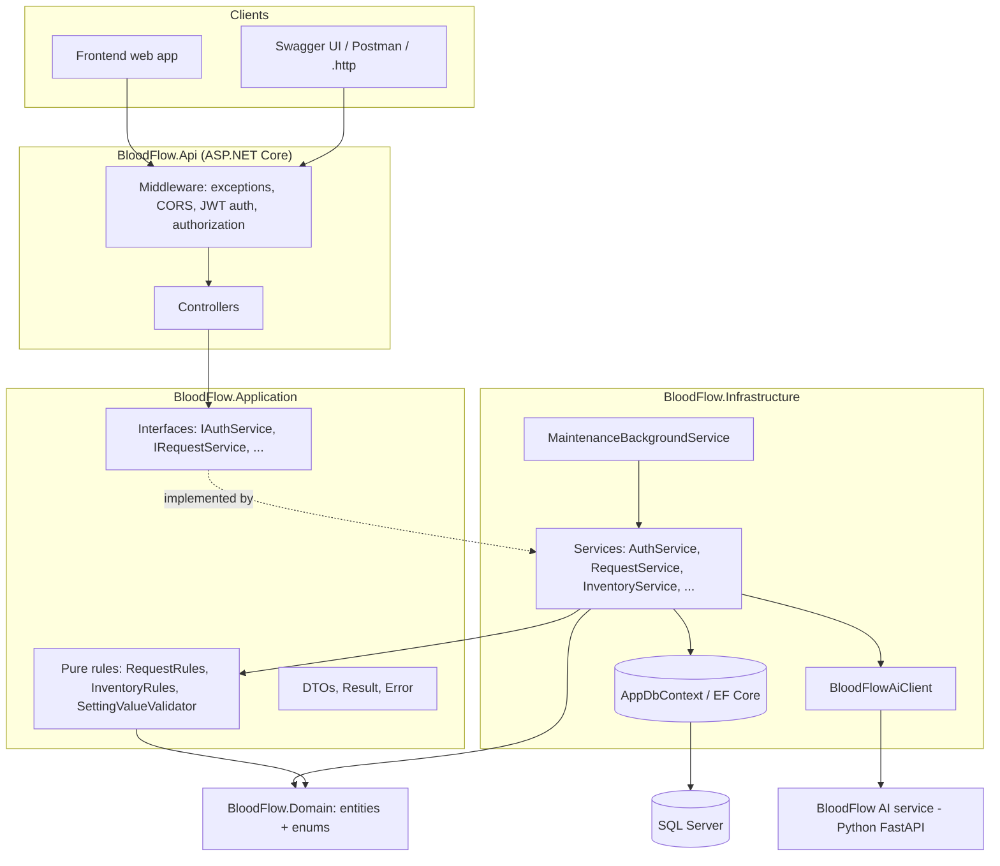
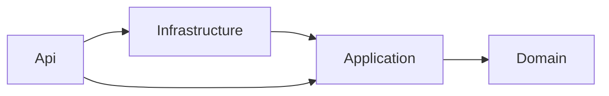
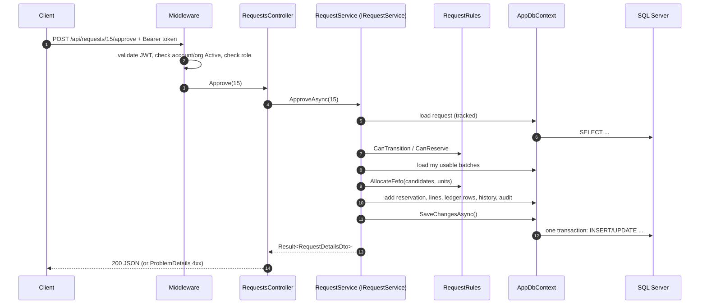
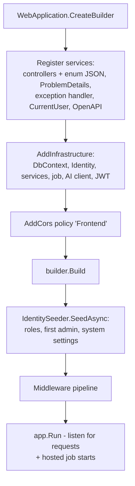

# PART 3 — Project Architecture

[← Master guide](../../BLOODFLOW_COMPLETE_MASTER_GUIDE.md)

---

## 3.1 The complete architecture



> 🇪🇬 الطلب بيدخل من الـ API، يعدّي على الـ Middleware (الحماية)، يوصل للـ Controller، اللي بينادي Interface، واللي بينفّذها Service في الـ Infrastructure. الـ Service بتستخدم القواعد النقية وEF Core عشان توصل للداتابيز.

---

## 3.2 Clean Architecture — what and why

**The idea:** put the business rules in the centre and make everything technical (database, web, external services) depend on them — never the other way round.



**Why we used it:**
| Benefit | Example in BloodFlow |
|---|---|
| Rules can be tested without a database | `RequestRules.AllocateFefo` has 6 test methods that run in milliseconds |
| Technology can change without touching rules | Replacing SQL Server would change Infrastructure only |
| Clear place for every kind of code | A new rule → Application; a new table → Domain + Infrastructure; a new URL → Api |
| Controllers stay small | Each controller method is 1–3 lines |

**Honest trade-off:** more projects and files than a single-project app. For a 1-developer graduation project this is acceptable and is a strong talking point.

> 🇪🇬 الفكرة إن قواعد الشغل (FEFO، مين يوافق، إمتى الطلب يتنفذ) تبقى في النص ومش عارفة حاجة عن الداتابيز أو الإنترنت. كده نقدر نختبرها لوحدها ونغيّر التكنولوجيا من غير مانلمسها.

---

## 3.3 Every project in the solution (`BloodFlow.slnx`)

| Project | SDK | References | Responsibility |
|---|---|---|---|
| `BloodFlow.Domain` | class library | — | Entities and enums. No packages. |
| `BloodFlow.Application` | class library | Domain | Interfaces, DTOs, `Result`/`Error`, pure rules, constants, `IClock`, `ICurrentUser` |
| `BloodFlow.Infrastructure` | class library | Application (→ Domain) | EF Core, Identity, JWT, service implementations, background job, AI client |
| `BloodFlow.Api` | web | Application, Infrastructure | Controllers, `Program.cs`, middleware, Swagger, CORS, `CurrentUser`, error handling |
| `BloodFlow.Tests` | xUnit | Application, Domain | Unit tests of pure rules |

**Why does Api reference Infrastructure?** Only to call `AddInfrastructure(...)` in `Program.cs` and to run the seeder (the "composition root"). Controllers never use Infrastructure classes directly — they use Application interfaces.

**Why is `CurrentUser` in Api but `ICurrentUser` in Application?** Only the web layer knows about `HttpContext`. Application defines the contract; Api implements it. This is Dependency Inversion in action.

---

## 3.4 Responsibility of each layer

| Layer | Allowed | Not allowed |
|---|---|---|
| Domain | Plain properties, enums, simple computed properties (`BloodBatch.AvailableQuantity`) | EF, HTTP, other projects |
| Application | Business rules without I/O, contracts, DTOs | `DbContext`, `HttpContext`, SQL |
| Infrastructure | Database, Identity, external HTTP, time zone, jobs | HTTP request handling (controllers) |
| Api | Routing, auth attributes, converting `Result` → HTTP | Business rules, database queries |

---

## 3.5 Folder structure

```
BloodFlow/
├── BLOODFLOW_COMPLETE_MASTER_GUIDE.md   ← this guide (entry point)
├── README.md, ARCHITECTURE.md, ... (companion docs)
├── .github/workflows/ci.yml
├── BloodFlow.slnx, global.json
├── docs/
│   ├── guide/                 Parts 2–13 of this guide
│   └── reports/               Arabic PDFs (Slices 1–3, defense guide)
├── src/
│   ├── BloodFlow.Domain/
│   │   ├── Entities/          AuditLog, BloodBatch, BloodGroup, BloodRequest, BloodRequestStatusHistory,
│   │   │                      EmergencyOverride, Governorate, InventoryTransaction, Organization,
│   │   │                      Reservation, ReservationLine, StaffProfile, SystemSetting
│   │   └── Enums/             AccountStatus, ActorType, AdjustmentReason, BatchSourceType, BatchStatus,
│   │                          ExpiryBasis, InventoryTransactionType, OrganizationStatus, OrganizationType,
│   │                          RequestEnums (7 enums), SettingValueType
│   ├── BloodFlow.Application/
│   │   ├── Common/            AppClaimTypes, AuditActions, Error, IClock, ICurrentUser, PagedResult,
│   │   │                      ReasonRequest, Result, Roles, SettingKeys
│   │   ├── Ai/ Audit/ Auth/ Inventory/ Lookups/ Organizations/ Requests/ Settings/ Staff/
│   ├── BloodFlow.Infrastructure/
│   │   ├── DependencyInjection.cs
│   │   ├── Ai/                AiJsonNamingPolicy, AiServiceCollectionExtensions, BloodFlowAiClient, BloodFlowAiOptions
│   │   ├── Authentication/    AuthService, JwtSettings, JwtTokenGenerator
│   │   ├── Common/            AuditLogger, RowVersionConverter, SettingsReader, SystemClock
│   │   ├── Identity/          ApplicationUser, IdentitySeeder
│   │   ├── Inventory/         BatchExpiryService, BatchRow, InventoryService, InventorySummaryBuilder
│   │   ├── Jobs/              MaintenanceBackgroundService
│   │   ├── Persistence/       AppDbContext, Configurations/ (11 files), Migrations/ (6 + snapshot), Seed/
│   │   ├── Requests/          RequestAdminService, RequestMaintenanceService, RequestReads, RequestService, ReservationLedger
│   │   └── Services/          AuditLogService, LookupService, OrganizationService, StaffAdminService, SystemSettingService
│   └── BloodFlow.Api/
│       ├── Program.cs, appsettings*.json, BloodFlow.Api.http, Properties/launchSettings.json
│       ├── Common/            CurrentUser, GlobalExceptionHandler, ResultExtensions
│       ├── Controllers/       AiController, AuthController, InventoryController, LookupsController, RequestsController
│       ├── Controllers/Admin/ AuditLogsController, InventoryReportsController, OrganizationsController,
│       │                      RequestsMonitorController, SettingsController, StaffController
│       └── OpenApi/           BearerSecuritySchemeTransformer
└── tests/BloodFlow.Tests/     Common/, Inventory/, Requests/, Settings/
```

**Rule of thumb:** folders are organized **by feature** (Inventory, Requests, …) inside each layer, so everything about one feature is easy to find.

---

## 3.6 Project references and why they point this way
- `Application → Domain`: rules talk about entities and enums.
- `Infrastructure → Application`: implements its interfaces; uses its DTOs and rules.
- `Api → Application`: controllers use interfaces and DTOs.
- `Api → Infrastructure`: composition root only.
- `Tests → Application, Domain`: tests pure code only (no database needed).
- **Never** `Domain → anything`, **never** `Application → Infrastructure`.

What breaks if you add `Application → Infrastructure`? A circular dependency (the build fails), and rules would start depending on EF Core.

---

## 3.7 Execution flow between layers



---

## 3.8 Dependency Injection and service registration

**Where:** `Infrastructure/DependencyInjection.cs` → `AddInfrastructure(IServiceCollection, IConfiguration)`, called from `Program.cs`.

```csharp
// ---------- Database ----------
services.AddDbContext<AppDbContext>(options =>
    options.UseSqlServer(configuration.GetConnectionString("DefaultConnection")));

// ---------- Application services ----------
services.AddScoped<AuditLogger>();
services.AddScoped<IAuthService, AuthService>();
...
// ---------- Inventory (Slice 2) ----------
services.AddSingleton<IClock, SystemClock>();
...
// ---------- Requests & reservations (Slice 3) ----------
services.AddScoped<IRequestService, RequestService>();
...
services.AddHostedService<MaintenanceBackgroundService>();
services.AddBloodFlowAi(configuration);
```

| Lifetime | Meaning | Used for |
|---|---|---|
| **Transient** | New object every time it is requested | (not used explicitly) |
| **Scoped** | One object per HTTP request | `AppDbContext`, all services, `AuditLogger`, `SettingsReader`, `ICurrentUser` |
| **Singleton** | One object for the whole app lifetime | `IClock` (stateless) |
| **Hosted service** | Started with the app, runs in the background | `MaintenanceBackgroundService` |

**Why `AppDbContext` must be scoped:** it tracks changes for one unit of work and is not thread-safe. A singleton DbContext would mix requests from different users.
**Why the job creates scopes:** it is a singleton-like hosted service; it asks `IServiceScopeFactory` for a new scope each run so it gets a fresh DbContext.

> 🇪🇬 الـ Scoped يعني نسخة جديدة لكل طلب، والـ Singleton نسخة واحدة للتطبيق كله. الـ DbContext لازم Scoped عشان كل مستخدم ليه جلسته.

---

## 3.9 How the application starts (`Program.cs`)



Middleware order and why:
| Order | Middleware | Why here |
|---|---|---|
| 1 | `UseExceptionHandler()` | First, so it catches exceptions from everything after it |
| 2 | `MapOpenApi()` + `UseSwaggerUI()` (conditional) | Documentation pages |
| 3 | `UseHttpsRedirection()` | Redirect http → https where an https port exists |
| 4 | `UseCors("Frontend")` | Before auth so browser **pre-flight** (OPTIONS) requests get CORS headers |
| 5 | `UseAuthentication()` | Reads the JWT and builds `User` |
| 6 | `UseAuthorization()` | Needs `User` from step 5 to check roles |
| 7 | `MapControllers()` | Runs the controller action |

What fails if Authentication comes after Authorization? Every `[Authorize]` endpoint returns 401, because authorization runs before the user is known.

**Startup can fail on purpose** if: `Jwt:Key` is missing (`DependencyInjection` throws), `AdminSeed` is missing or the admin password is too weak (seeder throws), or the database is unreachable (seeder queries it). On IIS this shows as **HTTP 500.30**.

---

## 3.10 Why we made these architectural decisions

| Decision | Reason | Alternative considered |
|---|---|---|
| Clean Architecture with 4 projects | Testable rules, clear structure, good for a defense | Single project (faster to start, messy later) |
| Feature folders inside layers | Everything about "Requests" is together | Folders by type (all services in one folder) |
| Services, not MediatR | Less ceremony for the project size | CQRS + MediatR |
| No repository layer | DbContext already is one; keep EF projections | Generic repository |
| Result pattern | Expected failures are values with stable codes | Exceptions for control flow |
| Pure rule classes | Unit tests without a database | Rules inside services (harder to test) |
| Business settings in a DB table | Change without redeploy, audited | Hard-coded constants |
| One hourly job for all maintenance | Simple, idempotent | Hangfire/Quartz |
| AI as a separate service behind our API | Python ecosystem for ML; key stays server-side | AI called directly from the browser |
