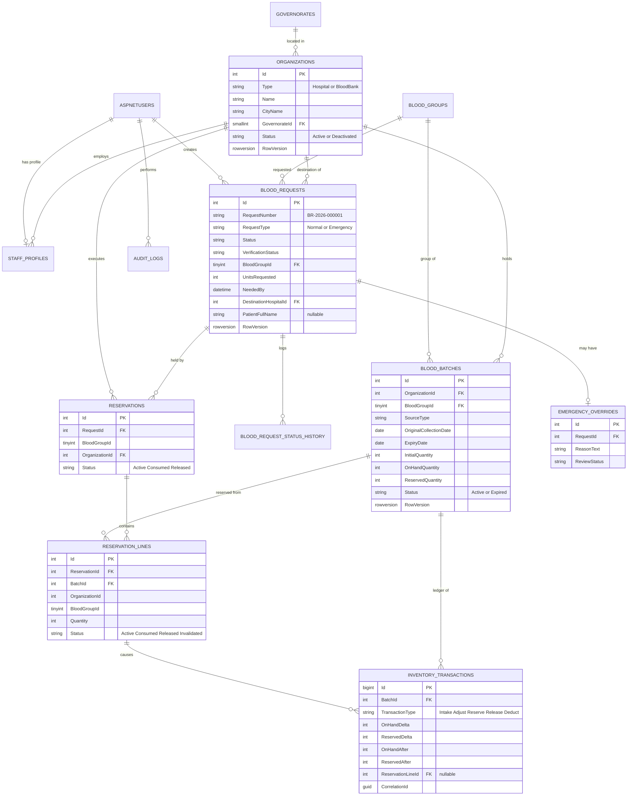
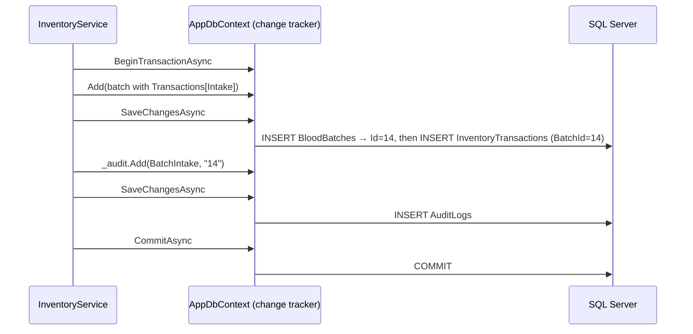

# PART 4 — Database Deep Dive

[← Master guide](../../BLOODFLOW_COMPLETE_MASTER_GUIDE.md) · Full column lists: [`DATABASE_DOCUMENTATION.md`](../../DATABASE_DOCUMENTATION.md) §6 (generated from EF's model snapshot)

---

## 4.1 The basics

### Relational database
Data is stored in **tables** that are related to each other by keys. A database server (SQL Server) stores them, runs queries (SQL) and guarantees rules (constraints, transactions).
> 🇪🇬 الداتابيز العلائقية = جداول مربوطة ببعض بأرقام. كل جدول عن حاجة واحدة (مؤسسات، دفعات، طلبات).

### SQL Server
Microsoft's relational database. We use it locally (SQL Server Express, e.g. `DESKTOP-…\SQLEXPRESS`) and in production (MonsterASP). The database collation is `Arabic_100_CI_AI` (case-insensitive, accent-insensitive Arabic).

### Table, column, row
| Term | BloodFlow example |
|---|---|
| Table | `BloodBatches` |
| Column | `ExpiryDate` (type `date`) |
| Row | "Batch 14: 6 units of O+ at blood bank 3, expires 2026-12-25" |

### Primary key (PK)
A column (or columns) that uniquely identifies each row. `BloodBatches.Id` is an `int` **identity** (SQL Server generates 1, 2, 3, …). `Governorates.Id` and `BloodGroups.Id` are **not** generated — we assign them (`ValueGeneratedNever`) because they are fixed reference data. `StaffProfiles.UserId` is both PK and FK (one profile per user). `SystemSettings.SettingKey` is a text PK.

### Foreign key (FK)
A column that points to a PK in another table. `BloodBatches.OrganizationId → Organizations.Id`. The database refuses a batch for an organization that doesn't exist.
> 🇪🇬 الـ FK زي ما تقولي "الدفعة دي تبع المؤسسة رقم 3"، والداتابيز ترفض لو مفيش مؤسسة رقم 3.

### Relationships
| Type | Meaning | BloodFlow example |
|---|---|---|
| One-to-one | One row ↔ one row | `AspNetUsers` 1 — 0..1 `StaffProfiles` (PK = FK `UserId`); `BloodRequests` 1 — 0..1 `EmergencyOverrides` (unique `RequestId`) |
| One-to-many | One row → many rows | `Organizations` 1 — * `BloodBatches`; `BloodRequests` 1 — * `BloodRequestStatusHistory` |
| Many-to-many | Many ↔ many via a join table | `AspNetUsers` * — * `AspNetRoles` through `AspNetUserRoles` (Identity) |

### Normalization
Store each fact once and link to it. Examples: the blood group code is stored once in `BloodGroups` and referenced by id; governorate names live only in `Governorates`; `Available` is **not stored** (it is `OnHand − Reserved`, computed), so it can never disagree with the other two columns. One deliberate **denormalization**: `ReservationLines` repeats `OrganizationId` and `BloodGroupId` so composite foreign keys can enforce "same bank, same blood group" (§4.4).
> 🇪🇬 الـ Normalization يعني كل معلومة تتكتب مرة واحدة بس. لو كررناها، ممكن نسختين يختلفوا.

---

## 4.2 ERD — based on the current source code

Only the 13 BloodFlow tables + `AspNetUsers` are drawn (other Identity tables are standard). Generated from the entity configurations.



> 🇪🇬 الرسم ده بيوضح الجداول وإزاي مربوطة: المؤسسة عندها دفعات، والدفعة ليها دفتر حركة، والطلب ليه حجز، والحجز فيه سطور كل سطر من دفعة.

---

## 4.3 All tables and the important properties

### Reference tables
**`Governorates`** (`Id` smallint, `Name` unique) — 27 rows seeded. **`BloodGroups`** (`Id` tinyint, `Code` unique) — 8 rows: 1 A+, 2 A−, 3 B+, 4 B−, 5 AB+, 6 AB−, 7 O+, 8 O−.

### `Organizations` — entity `Organization`
| Property | Meaning |
|---|---|
| `Id` | PK |
| `Type` | `Hospital` / `BloodBank`. Cannot change after creation (the update DTO has no `Type`). |
| `Name`, `CityName` | Unique together with `GovernorateId` (`Name, GovernorateId`) |
| `GovernorateId` | FK → `Governorates` (used for the requests board) |
| `Status` | `Active` / `Deactivated` |
| `RowVersion` | Concurrency token for admin edits |

### `AspNetUsers` — entity `ApplicationUser : IdentityUser<int>`
Identity's columns (`Email`, `NormalizedEmail`, `PasswordHash`, `LockoutEnd`, `AccessFailedCount`, …) + ours: `FullName`, `AccountStatus` (`Pending`/`Active`/`Rejected`/`Deactivated`, DB default `Pending`), `CreatedAt`. `EmailIndex` on `NormalizedEmail` is **unique**.

### `StaffProfiles` — entity `StaffProfile`
`UserId` (PK + FK), `OrganizationId`, `StaffKind` (`Hospital`/`BloodBank`), `JobTitle`, `ApprovedByUserId`, `ApprovedAt`, `RejectionReason`. Composite FK `(OrganizationId, StaffKind) → Organizations(Id, Type)`.

### `SystemSettings` — entity `SystemSetting`
`SettingKey` (PK), `SettingValue`, `ValueType` (`Int`/`Decimal`/`Bool`/`String`), `Description`, `IsMedicalParameter`, `ApprovalReference`, `ApprovedByUserId/At`, `UpdatedByUserId/At`, `RowVersion`.

### `AuditLogs` — entity `AuditLog`
`OccurredAt`, `ActorType` (`User`/`System`), `ActorUserId`, `ActorRole`, `OrganizationId`, `Action` (e.g. `Request.Approved`), `EntityType`, `EntityId`, `OldValues`/`NewValues` (JSON), `Reason`, `CorrelationId`, `IpAddress`.

### `BloodBatches` — entity `BloodBatch`
| Property | Meaning |
|---|---|
| `OrganizationId`, `BloodGroupId` | Where and what |
| `SourceType` | `ManualIntake` (today), `Donation`/`Transfer` (📋 planned) |
| `OriginalCollectionDate`, `ExpiryDate` | `date` columns (`DateOnly` in C#) |
| `ExpiryBasis` | `Entered` (staff typed it) or `DefaultShelfLife` (collection + 35 days) |
| `InitialQuantity` | Units at intake |
| `OnHandQuantity` | Units physically present |
| `ReservedQuantity` | Units held for requests |
| `Status`, `ExpiredAt` | `Active`/`Expired` |
| `CreatedAt`, `CreatedByUserId` | Who recorded it |
| `RowVersion` | Concurrency |
| `AvailableQuantity` | **C# only** (`builder.Ignore(...)`): `Status == Active ? OnHand − Reserved : 0` |

### `InventoryTransactions` — entity `InventoryTransaction` (append-only ledger)
`BatchId`, `OrganizationId`, `TransactionType`, `OnHandDelta`, `ReservedDelta`, `OnHandAfter`, `ReservedAfter`, `ReservationLineId`, `ReasonCode` (`Damaged`/`Expired`/`Correction`), `Reason`, `ActorType`, `PerformedByUserId`, `ClientRequestId`, `CorrelationId`, `CreatedAt`.

| Type | OnHand | Reserved | Created by |
|---|---|---|---|
| Intake | +n | 0 | `InventoryService.IntakeAsync` |
| Adjust | ±n | 0 | `InventoryService.AdjustAsync` |
| Reserve | 0 | +n | `ReservationLedger.Reserve` (approve/reallocate) |
| Release | 0 | −n | `ReservationLedger.Release` (cancel, expiry invalidation) |
| Deduct | −n | −n | `ReservationLedger.Deduct` (fulfil) |

### `BloodRequests` — entity `BloodRequest`
| Property | Meaning |
|---|---|
| `RequestNumber` | `BR-yyyy-000001` from sequence `BloodRequestNumbers` |
| `RequestType` | `Normal` / `Emergency` |
| `Status` | `Pending`/`Approved`/`Fulfilled`/`Received`/`Rejected`/`Cancelled` |
| `VerificationStatus` | `Unverified`/`Verified` (hospital-created → Verified) |
| `BloodGroupId`, `UnitsRequested`, `NeededBy` (UTC) | The need |
| `DestinationHospitalId`, `DestinationOrgType` (always `Hospital`) | Where it goes |
| `CreatedByUserId`, `RequesterCapacity` | Who asked; capacity `HospitalStaff` today (`Patient`/`Representative` 📋) |
| `PatientFullName`, `PatientAnonymizedAt`, `RelationshipToPatient` | Privacy-controlled |
| `VerifiedByUserId`, `VerifiedAt`, `EmergencyOverrideUsed` | Verification trail |
| `ClientRequestId` | Idempotency |
| `CreatedAt`, `StatusChangedAt` | Times (used for flags) |
| `RowVersion` | Concurrency |

### `BloodRequestStatusHistory`, `Reservations`, `ReservationLines`, `EmergencyOverrides`
See the ERD above and §4.4. `Reservation` = which organization holds stock for which request (`Active`/`Consumed`/`Released`, `ClosedAt`). `ReservationLine` = quantity from one batch (`Active`/`Consumed`/`Released`/`Invalidated` + `InvalidationReason`). `EmergencyOverride` = reason, who, when, review status/notes.

---

## 4.4 Keys, indexes and constraints

### Composite foreign keys (the strongest integrity rules)
```csharp
// ReservationConfiguration.cs — a reserved batch must be at the SAME organization
// and have the SAME blood group as the reservation line.
builder.HasOne(l => l.Batch)
    .WithMany()
    .HasForeignKey(l => new { l.BatchId, l.OrganizationId, l.BloodGroupId })
    .HasPrincipalKey(b => new { b.Id, b.OrganizationId, b.BloodGroupId })
    .OnDelete(DeleteBehavior.Restrict);
```
`HasPrincipalKey` creates an **alternate key** (a unique constraint) on the target columns so a foreign key can point at them.

| FK | Guarantees |
|---|---|
| `StaffProfiles(OrganizationId, StaffKind) → Organizations(Id, Type)` | Hospital staff only in hospitals, bank staff only in banks |
| `BloodRequests(DestinationHospitalId, DestinationOrgType='Hospital') → Organizations(Id, Type)` | Destination is a hospital |
| `Reservations(RequestId, BloodGroupId) → BloodRequests(Id, BloodGroupId)` | Same blood group as the request |
| `ReservationLines(ReservationId, OrganizationId, BloodGroupId) → Reservations(...)` | Line matches its reservation |
| `ReservationLines(BatchId, OrganizationId, BloodGroupId) → BloodBatches(...)` | Batch matches the line |
| `EmergencyOverrides(RequestId, RequestType='Emergency') → BloodRequests(Id, RequestType)` | Overrides only on emergencies |

> 🇪🇬 الـ Composite FK بيقول "الكيس ده لازم يكون من نفس البنك ونفس الفصيلة". حتى لو الكود فيه غلطة، الداتابيز هترفض.

### Indexes (why each exists)
| Index | Query it serves |
|---|---|
| `BloodBatches(OrganizationId, BloodGroupId, Status, ExpiryDate)` | FEFO: usable batches of a group at my org |
| `BloodBatches(Status, ExpiryDate)` | Hourly job: active batches past expiry |
| `InventoryTransactions(OrganizationId, CreatedAt)` | Ledger page |
| `InventoryTransactions(ClientRequestId)` unique filtered | Idempotency |
| `BloodRequests(RequestNumber)` unique | Request lookup |
| `BloodRequests(ClientRequestId)` unique filtered | Idempotency |
| `BloodRequests(Status, RequestType, NeededBy)` | Board |
| `BloodRequests(DestinationHospitalId, Status)` | Hospital list |
| `BloodRequests(DestinationHospitalId, BloodGroupId, CreatedAt)` | Duplicate check |
| `BloodRequestStatusHistory(RequestId, ToStatus)` unique | Each status reached once |
| `Reservations(RequestId)` unique filtered `UX_Reservations_OneLivePerRequest` | One live reservation per request |
| `ReservationLines(BatchId, Status)` | Lines on a batch (expiry job) |
| `EmergencyOverrides(RequestId)` unique, `(ReviewStatus)` | One per request; review list |
| `Organizations(Name, GovernorateId)` unique | No duplicate org names per governorate |
| `AuditLogs(OccurredAt)`, `(EntityType, EntityId)` | Audit filters |

### CHECK constraints (38 in total)
Examples: `CK_BloodBatches_OnHandCoversReserved` `[OnHandQuantity] >= [ReservedQuantity]`; `CK_BloodBatches_Dates` `[ExpiryDate] > [OriginalCollectionDate]`; `CK_BloodRequests_FulfilledIsVerified` `[Status] NOT IN ('Fulfilled','Received') OR [VerificationStatus] = 'Verified' OR [EmergencyOverrideUsed] = 1`; `CK_BloodRequestStatusHistory_Transition` (only allowed transitions); `CK_InventoryTransactions_ReservationLine` (Reserve/Release/Deduct need a line); `CK_AuditLogs_Actor` (User needs an id, System must not have one). Every enum column also has a CHECK listing its allowed values. Full list: `DATABASE_DOCUMENTATION.md`.

---

## 4.5 Enum and status handling
- C# enums in `Domain/Enums/`.
- Stored as **text**: `builder.Property(b => b.Status).HasConversion<string>().HasMaxLength(10).IsUnicode(false);` → column `varchar(10)` containing `Active`.
- A CHECK constraint lists the allowed strings.
- In JSON, `JsonStringEnumConverter` (in `Program.cs`) makes them text too.
**Why text?** Readable in SSMS and in the API; if someone reorders the C# enum, stored data stays correct (with integers, `Approved` could silently become `Rejected`).

---

## 4.6 Entity Framework Core — how it works

### `AppDbContext` and `DbSet`
```csharp
public class AppDbContext : IdentityDbContext<ApplicationUser, IdentityRole<int>, int>
{
    protected override void OnModelCreating(ModelBuilder modelBuilder)
    {
        base.OnModelCreating(modelBuilder);                       // Identity's tables
        modelBuilder.UseCollation("Arabic_100_CI_AI");
        modelBuilder.ApplyConfigurationsFromAssembly(typeof(AppDbContext).Assembly);
        modelBuilder.HasSequence<int>(Configurations.BloodRequestConfiguration.NumberSequence).StartsAt(1);
    }
    public DbSet<BloodBatch> BloodBatches { get; set; } = null!;
    // ... 12 more DbSets
}
```
- `IdentityDbContext<…, int>` adds the Identity tables with `int` keys.
- `ApplyConfigurationsFromAssembly` finds every `IEntityTypeConfiguration<T>` class in Infrastructure automatically.
- A `DbSet<T>` is a table you can query with LINQ and add rows to.
> 🇪🇬 الـ DbContext هو الجلسة مع الداتابيز. الـ DbSet هو الجدول جوّاها.

### Fluent API configurations
One class per entity in `Persistence/Configurations/`. Real example (`BloodBatchConfiguration.cs`):
```csharp
builder.HasKey(b => b.Id);
builder.Ignore(b => b.AvailableQuantity);                       // computed in C#, not a column
builder.Property(b => b.Status).HasConversion<string>().HasMaxLength(10).IsUnicode(false);
builder.Property(b => b.ExpiryDate).HasColumnType("date");      // DateOnly → date
builder.Property(b => b.RowVersion).IsRowVersion();             // concurrency token
builder.HasOne(b => b.Organization).WithMany()
       .HasForeignKey(b => b.OrganizationId).OnDelete(DeleteBehavior.Restrict);
builder.HasIndex(b => new { b.OrganizationId, b.BloodGroupId, b.Status, b.ExpiryDate });
```
**Why Fluent API and not attributes on entities?** It keeps the Domain free of EF, and some things (composite FKs, filtered indexes, CHECKs) can only be done with Fluent API.

### Migrations
A migration is a C# class with `Up` (apply) and `Down` (revert) generated from the difference between your model and the last snapshot (`AppDbContextModelSnapshot.cs`).

| Migration | Content |
|---|---|
| `InitialCreate` | Governorates, BloodGroups, Organizations |
| `SeedReferenceData` | 27 governorates + 8 blood groups (`InsertData`) |
| `AddIdentity` | 7 Identity tables |
| `AddAdminSlice` | User columns, unique email, `AK_Organizations_Id_Type`, StaffProfiles, SystemSettings, AuditLogs |
| `AddInventory` | BloodBatches, InventoryTransactions |
| `AddRequests` | Sequence, 5 request tables, `ReservationLineId`, batch alternate key |

`__EFMigrationsHistory` records which migrations were applied. Note: the collation is used when EF **creates** the database; a database created in a hosting control panel must be created with `Arabic_100_CI_AI` by hand.

### Seeding
| Data | Method | When |
|---|---|---|
| Governorates, blood groups | `HasData(...)` in configurations → migration | `database update` |
| Roles, first admin | `IdentitySeeder` | every startup (only missing ones) |
| System settings | `SystemSettingSeeder` | every startup (insert missing keys, never overwrite) |
Why not `HasData` for settings? `HasData` would overwrite an admin's change on the next migration and conflict with `rowversion`.

---

## 4.7 RowVersion and concurrency (implemented)
`rowversion` is an 8-byte value SQL Server changes on every update. EF sends `WHERE Id = @id AND RowVersion = @original` in UPDATE statements. If another user changed the row, 0 rows are affected → `DbUpdateConcurrencyException`.

How it reaches the client (admin edits): `RowVersionConverter.ToBase64(...)` sends it as text; on update the client sends it back; the service sets it as the **original value**:
```csharp
// OrganizationService.UpdateAsync
if (!RowVersionConverter.TryParse(request.RowVersion, out var rowVersion))
    return Error.Validation("Organization.InvalidRowVersion", "RowVersion is missing or invalid.");
// ...
_db.Entry(organization).Property(o => o.RowVersion).OriginalValue = rowVersion;
```
Then a conflict → `Organization.Concurrency` 409 (or `GlobalExceptionHandler` → 409 `Concurrency`).
> 🇪🇬 الـ RowVersion رقم بيتغير مع كل تعديل. لو انتي فتحتي المؤسسة وحد تاني عدّلها قبلك، الحفظ بتاعك يرفض بـ 409 بدل ما يمسح تعديله.

---

## 4.8 How a request reaches the database and how data is saved

Example: blood bank records a new batch (`POST /api/inventory/batches`) — `InventoryService.IntakeAsync`:
1. `TryGetCaller` → organization id and user id from the token.
2. Idempotency: `clientRequestId` seen before? → return that batch.
3. Check blood group exists; read `Inventory.DefaultShelfLifeDays`; `InventoryRules.ValidateIntake(...)`.
4. Build the `BloodBatch` and add the `Intake` ledger row **through the navigation** `batch.Transactions.Add(...)` so EF fills `BatchId` automatically.
5. Transaction: `Add(batch)` → `SaveChangesAsync` (gets `batch.Id`) → `_audit.Add(...)` → `SaveChangesAsync` → `CommitAsync`.
6. Return the DTO.


**Change tracking:** EF remembers entities you loaded or added; `SaveChangesAsync` compares them and sends only the needed INSERT/UPDATE statements in one transaction. `AsNoTracking()` is used for read-only queries because it's faster.
