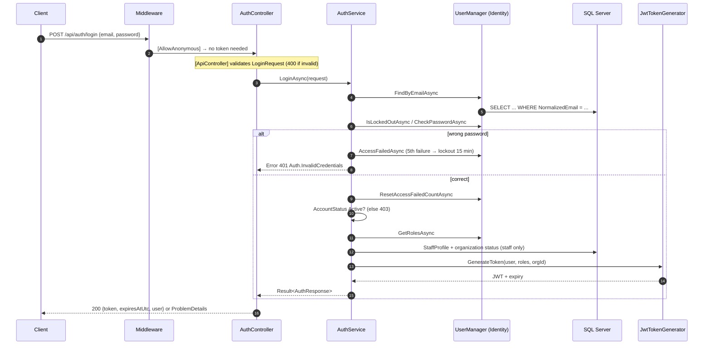
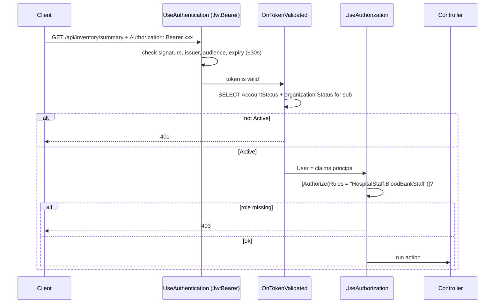

# PART 5 — Authentication and Authorization

[← Master guide](../../BLOODFLOW_COMPLETE_MASTER_GUIDE.md)

---

## 5.1 Authentication vs Authorization

| | Question | In BloodFlow | HTTP failure |
|---|---|---|---|
| **Authentication** | *Who are you?* | Login checks email + password; later every request proves identity with the JWT | **401** |
| **Authorization** | *What may you do?* | `[Authorize(Roles = ...)]` + ownership checks in services (your organization only) | **403** (or **404** for other organizations' records) |

> 🇪🇬 الـ Authentication: انت مين؟ (الـ Login والكارنيه). الـ Authorization: مسموحلك تعمل إيه؟ (الدور ومؤسستك).

---

## 5.2 ASP.NET Core Identity

A ready-made system for users, password hashing, roles, lockout, stored through EF Core.

**Setup** (`Infrastructure/DependencyInjection.cs`):
```csharp
services.AddIdentityCore<ApplicationUser>(options =>
{
    options.Password.RequireDigit = true;
    options.Password.RequireLowercase = true;
    options.Password.RequireUppercase = true;
    options.Password.RequireNonAlphanumeric = false;
    options.Password.RequiredLength = 8;
    options.User.RequireUniqueEmail = true;

    // Brute-force protection: 5 wrong passwords → locked for 15 minutes.
    options.Lockout.AllowedForNewUsers = true;
    options.Lockout.MaxFailedAccessAttempts = 5;
    options.Lockout.DefaultLockoutTimeSpan = TimeSpan.FromMinutes(15);
})
.AddRoles<IdentityRole<int>>()
.AddEntityFrameworkStores<AppDbContext>();
```
- `AddIdentityCore` = users + password checks without cookie sign-in UI (we use JWT).
- `.AddRoles<IdentityRole<int>>()` = role support with `int` keys.
- `.AddEntityFrameworkStores<AppDbContext>()` = store them in our database.

**Main classes you use:** `UserManager<ApplicationUser>` (find, create, check password, add role, lockout counters) and `RoleManager<IdentityRole<int>>` (create roles).

---

## 5.3 Users and Roles

- **User** = a row in `AspNetUsers`. **Role** = a row in `AspNetRoles`. The link = `AspNetUserRoles` (many-to-many).
- BloodFlow gives each user **one** role (comment in `AuthService`: "One role per user in BloodFlow").
- Role names are constants (`Application/Common/Roles.cs`): `SystemAdmin`, `HospitalStaff`, `BloodBankStaff`, `Donor`, `Recipient` and `Roles.AllRoles` (used by the seeder).

### `ApplicationUser` (`Infrastructure/Identity/ApplicationUser.cs`)
```csharp
public class ApplicationUser : IdentityUser<int>
{
    public string FullName { get; set; } = string.Empty;
    /// Only Active accounts can sign in. Staff start as Pending until approved.
    public AccountStatus AccountStatus { get; set; } = AccountStatus.Pending;
    public DateTime CreatedAt { get; set; }
}
```
- `IdentityUser<int>` gives `Id`, `Email`, `UserName`, `PasswordHash`, `LockoutEnd`, `AccessFailedCount`, …
- We add `FullName`, `AccountStatus` (business status independent of Identity), `CreatedAt`.
- Why in Infrastructure, not Domain? It inherits from an Identity class (a framework type); Domain must stay framework-free.

---

## 5.4 Role seeding and the initial admin (`Infrastructure/Identity/IdentitySeeder.cs`)

Called in `Program.cs` right after `builder.Build()`:
```csharp
await IdentitySeeder.SeedAsync(app.Services);
```
1. **Roles:** for each name in `Roles.AllRoles`, `RoleExistsAsync` → if missing `CreateAsync`. Safe to run on every start.
2. **Admin:** reads `AdminSeed:Email` and `AdminSeed:Password` (User Secrets locally; server file in production). If missing → throws (startup stops on purpose).
   - Not found → creates `ApplicationUser { UserName = email, Email = email, EmailConfirmed = true, FullName = "System Administrator", AccountStatus = Active }` with the password.
   - Found but not Active or without a name (an admin created before those columns existed) → repairs it.
   - Ensures it has the `SystemAdmin` role.
3. **System settings:** `SystemSettingSeeder.SeedAsync(db)` inserts missing keys.

> 🇪🇬 كل ما السيرفر يقوم، بيتأكد إن الأدوار الخمسة موجودة، وإن فيه أدمن بالإيميل والباسورد اللي في الإعدادات. لو مش موجود يعمله.

---

## 5.5 JWT, Claims, Access Tokens

**JWT** = `header.payload.signature`, Base64URL-encoded.
- **Header:** algorithm (`HS256`).
- **Payload:** the **claims** (facts about the user) + `iss`, `aud`, `exp`.
- **Signature:** HMAC-SHA256 of header+payload using the secret `Jwt:Key`.
Anyone can *read* a JWT (try jwt.io), but nobody can *change* it without the key, because the signature would no longer match.

**Claims in a BloodFlow token** (`AppClaimTypes`, `JwtTokenGenerator`):
| Claim | Value | Used for |
|---|---|---|
| `sub` | user id | `ICurrentUser.UserId` |
| `email` | email | display |
| `name` | full name | display |
| `role` | `HospitalStaff`, … | `[Authorize(Roles=...)]` |
| `org_id` | organization id (staff only) | `ICurrentUser.OrganizationId` — scoping every staff action |
| `jti` | random GUID | unique token id |

**Access token** = this JWT. Lifetime = `Jwt:ExpiryMinutes` (60). There is **no refresh token**: after 60 minutes the user logs in again.

> 🇪🇬 الـ JWT كارنيه رقمي: فيه رقمك ودورك ومؤسستك، وعليه ختم (Signature) محدش يقدر يزوّره من غير المفتاح السري.

---

## 5.6 `JwtSettings` configuration (Options pattern)

```csharp
public class JwtSettings
{
    public const string SectionName = "Jwt";
    public string Issuer { get; set; } = null!;
    public string Audience { get; set; } = null!;
    public string Key { get; set; } = null!;
    public int ExpiryMinutes { get; set; }
}
```
Values: `appsettings.json` → `"Jwt": { "Issuer": "BloodFlow.Api", "Audience": "BloodFlow.Client", "ExpiryMinutes": 60 }`; `Jwt:Key` → User Secrets / server file.
Registered with `services.Configure<JwtSettings>(configuration.GetSection(JwtSettings.SectionName));` and injected as `IOptions<JwtSettings>` into `JwtTokenGenerator`. `AddInfrastructure` also reads it directly and **throws if `Key` is empty**.

---

## 5.7 `LoginRequest` and `AuthResponse`

```csharp
public sealed record LoginRequest
{
    [Required, EmailAddress, StringLength(256)] public string Email { get; init; } = string.Empty;
    [Required, StringLength(128)]               public string Password { get; init; } = string.Empty;
}

public sealed record AuthResponse(string Token, DateTime ExpiresAtUtc, AuthUserDto User);
public sealed record AuthUserDto(int Id, string FullName, string Email, string Role, int? OrganizationId);
```
`init` means the property can be set only when the object is created (by the JSON binder), then it's read-only.

---

## 5.8 `IAuthService` and `AuthService`

```csharp
public interface IAuthService
{
    Task<Result<AuthResponse>> LoginAsync(LoginRequest request, CancellationToken cancellationToken = default);
    Task<Result<RegisterStaffResponse>> RegisterStaffAsync(RegisterStaffRequest request, CancellationToken cancellationToken = default);
}
```
`AuthService` (Infrastructure) depends on `UserManager<ApplicationUser>`, `AppDbContext`, `JwtTokenGenerator`, `AuditLogger`.

**`LoginAsync` — step by step (real code, shortened):**
```csharp
var user = await _userManager.FindByEmailAsync(request.Email.Trim());
if (user is null) return InvalidCredentials;                        // 401

if (await _userManager.IsLockedOutAsync(user))
    return Error.Forbidden("Auth.LockedOut", "Too many failed attempts. Try again later.");

if (!await _userManager.CheckPasswordAsync(user, request.Password))
{
    await _userManager.AccessFailedAsync(user);                       // count the failure
    return InvalidCredentials;                                        // same 401 message
}
await _userManager.ResetAccessFailedCountAsync(user);

// The password is correct, so it is safe to tell the user WHY they cannot sign in.
var statusError = user.AccountStatus switch
{
    AccountStatus.Pending => Error.Forbidden("Auth.AccountPending", "..."),
    AccountStatus.Rejected => Error.Forbidden("Auth.AccountRejected", "..."),
    AccountStatus.Deactivated => Error.Forbidden("Auth.AccountDeactivated", "..."),
    _ => null
};
if (statusError is not null) return statusError;

var roles = await _userManager.GetRolesAsync(user);
// staff → load StaffProfile; must exist and its organization must be Active → organizationId
var token = _jwtTokenGenerator.GenerateToken(user, roles, organizationId);
return new AuthResponse(token.Value, token.ExpiresAtUtc,
    new AuthUserDto(user.Id, user.FullName, user.Email!, roles.FirstOrDefault() ?? string.Empty, organizationId));
```
**Why the status message only after the password is correct?** Otherwise an attacker could learn that an email exists and is pending without knowing the password.

**`RegisterStaffAsync`:** organization must exist and be Active → email not taken → role from organization type (client can't choose) → **transaction**: create user (Pending) → add role → add `StaffProfile` → audit row (actor = the new user) → save → commit. Identity errors map to `Registration.WeakPassword` / `Registration.Invalid` / `Registration.EmailTaken`.

---

## 5.9 `AuthController`

```csharp
[ApiController]
[Route("api/auth")]
[AllowAnonymous]
public class AuthController : ControllerBase
{
    [HttpPost("login")]
    public async Task<IActionResult> Login(LoginRequest request, CancellationToken cancellationToken)
    {
        var result = await _authService.LoginAsync(request, cancellationToken);
        return result.ToActionResult(this);
    }

    [HttpPost("register/staff")]
    public async Task<IActionResult> RegisterStaff(RegisterStaffRequest request, CancellationToken cancellationToken) { ... } // 201 on success
}
```
`[AllowAnonymous]` because you can't have a token before logging in.

---

## 5.10 The complete login process



---

## 5.11 What happens on every later request


The `OnTokenValidated` check (in `DependencyInjection.cs`) is why a deactivated staff member is blocked **immediately**, not after the token expires.

---

## 5.12 How `[Authorize]` and roles work

| Attribute | Effect |
|---|---|
| `[AllowAnonymous]` | No token needed (Auth, Lookups, `GET /api/ai/health`) |
| `[Authorize]` | Any valid token |
| `[Authorize(Roles = "A,B")]` | Valid token **and** role A **or** B |
| Class `[Authorize(Roles=X)]` + method `[Authorize(Roles=Y)]` | **Both** must pass (AND) |

Real examples:
- `RequestsController`: class `[Authorize(Roles = Roles.Staff)]`; `Create` and `Verify` also `[Authorize(Roles = Roles.HospitalStaff)]` → must be staff **and** hospital staff.
- `AiController`: class allows admin + staff; `Retrain` adds `[Authorize(Roles = Roles.SystemAdmin)]` → admin only; `Health` has `[AllowAnonymous]`, which overrides the class.
- That AND rule is why the admin's cancel route is in `Admin/RequestsMonitorController` (`POST /api/admin/requests/{id}/cancel`) instead of the staff controller.

**Roles are not enough — ownership checks:** services read `ICurrentUser.OrganizationId` and only touch that organization's data. Example `RequestService.LoadForExecutorAsync`: if the live reservation isn't held by my organization → `403 Request.NotExecutor`. Inventory queries filter by organization; another organization's batch → `404`.

> 🇪🇬 الـ Role بيقول "انت موظف بنك دم"، بس الـ Service بتتأكد كمان إن الحاجة دي تبع بنكك انت.

---

## 5.13 Password hashing and security

- Passwords are never stored. Identity's `PasswordHasher` stores a **salted hash** (PBKDF2 in Identity's v3 format). Checking = hash the typed password the same way and compare.
- **Lockout:** 5 failures → 15 minutes (`AccessFailedAsync`, `IsLockedOutAsync`).
- **Same error** for unknown email and wrong password.
- **Policy:** ≥ 8 chars, digit, lowercase, uppercase (non-alphanumeric not required).
- **Secrets:** `Jwt:Key` and admin password in User Secrets/server file, never in Git.
- **Token lifetime** 60 min, `ClockSkew` 30 s (default is 5 min).
- **Re-validation** of account/organization on every request.

Known gaps (Part 11): no rate limiting on login/register, `Jwt:Key` length not validated at startup, no refresh tokens, no password reset, no email confirmation.
