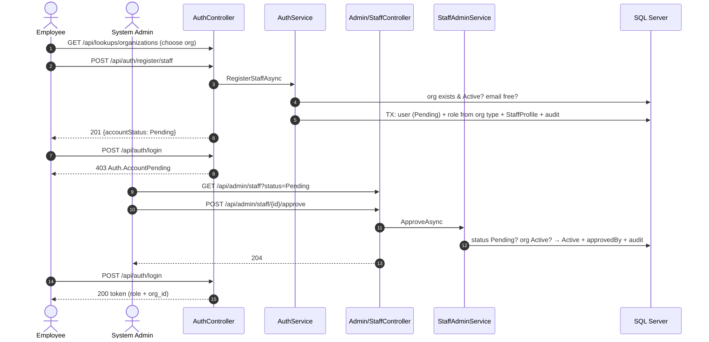
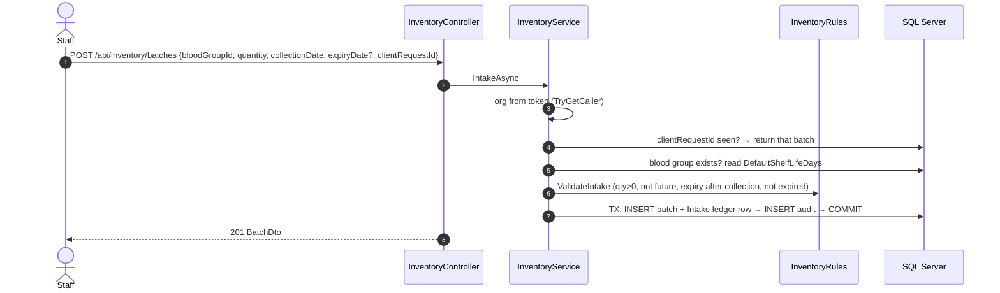
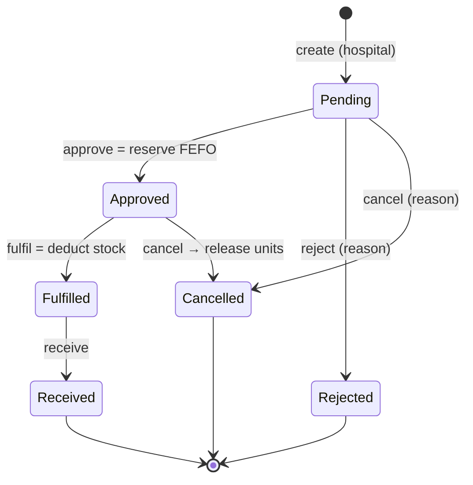
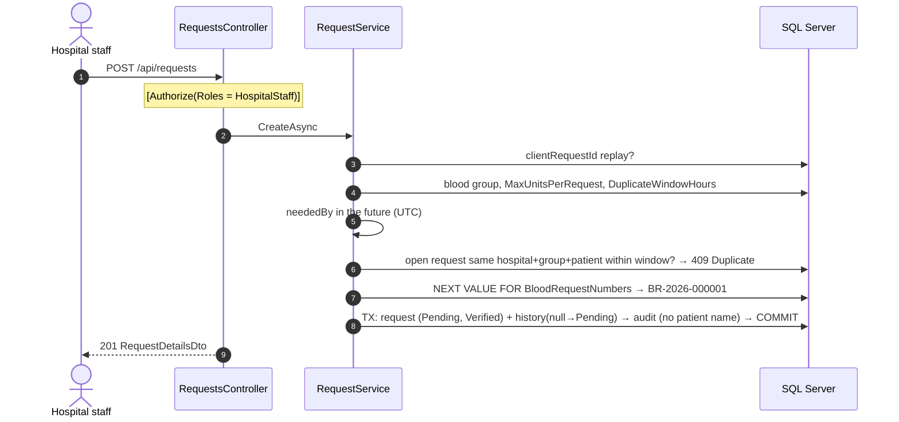
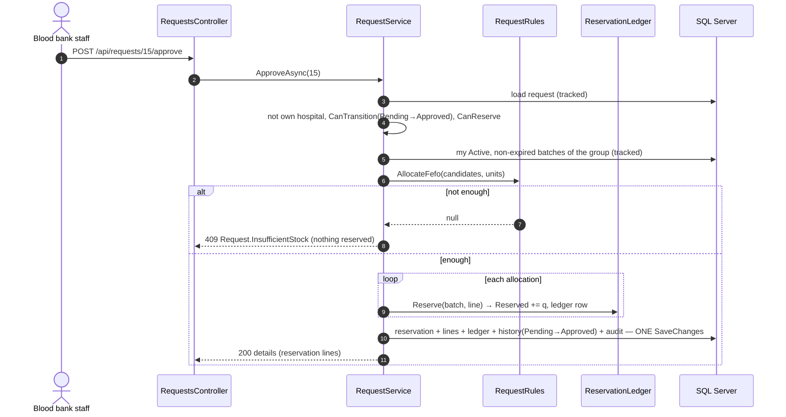
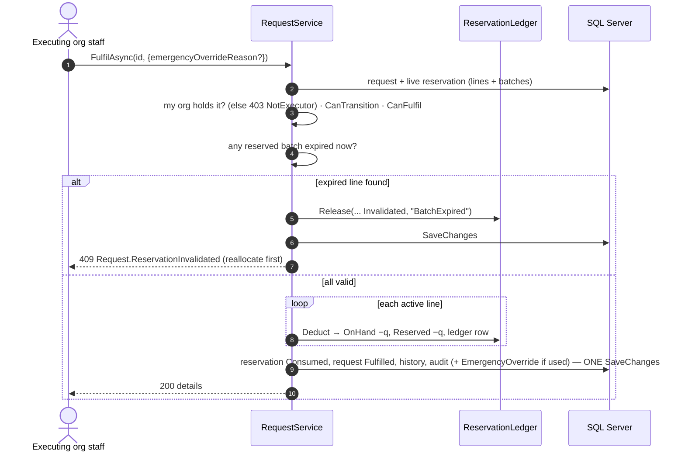
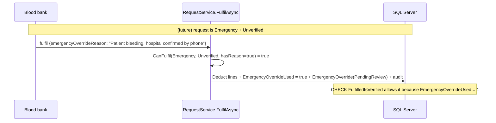
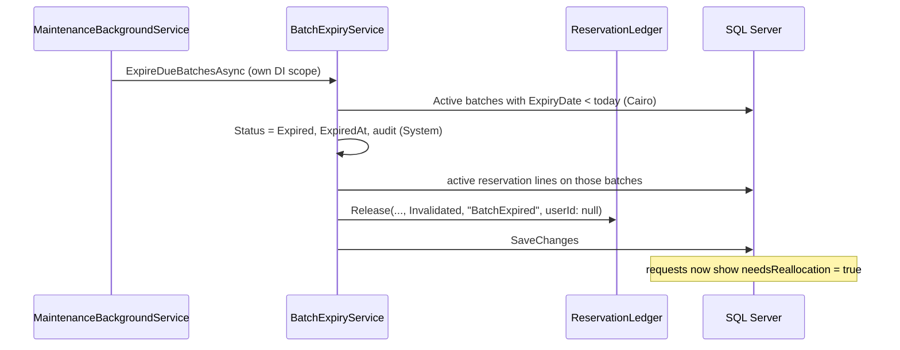

# PART 8 — Complete Business Workflows

[← Master guide](../../BLOODFLOW_COMPLETE_MASTER_GUIDE.md)

Each workflow is marked ✅ implemented, 🟡 partial, or 📋 planned. Implemented workflows show the **real classes**; planned ones show the Phase 1 design only.

---

## 8.1 ✅ Staff registration and approval (Phase 1 A1)


**Classes:** `AuthController`, `AuthService`, `StaffController`, `StaffAdminService`, `AuditLogger`. Also reject (`Pending → Rejected` with reason), deactivate (`Active → Deactivated`, immediate block via `OnTokenValidated`), reactivate.

> 🇪🇬 الموظف يسجّل نفسه، حسابه يبقى Pending، والأدمن يوافق، وبعدها بس يقدر يعمل Login.

---

## 8.2 ✅ Login
Full sequence in Part 5 §5.10. Classes: `AuthController` → `AuthService` → `UserManager` → `JwtTokenGenerator`.

---

## 8.3 ✅ Organization management (A2)
Admin creates hospitals/blood banks (`POST /api/admin/organizations`), edits them with `rowVersion`, deactivates them (refused with `Organization.HasOpenWork` if they have active reservations or Pending/Approved/Fulfilled requests). Deactivating an organization blocks its staff on their next request (`OnTokenValidated`). Classes: `OrganizationsController`, `OrganizationService`.

---

## 8.4 ✅ Blood bank / hospital inventory management (B1, H4)

### Intake


### Adjustment
`POST /api/inventory/batches/{id}/adjust` → `InventoryService.AdjustAsync` → load **my** batch → `InventoryRules.ValidateAdjustment` (Damaged/Expired decrease only; never below reserved) → `OnHand` changes + `Adjust` ledger row with reason + audit → one save.

### Read
`GET /api/inventory/summary` (per blood group, near-expiry, expired), `GET /api/inventory/batches` (FEFO order), `GET /api/inventory/transactions` (ledger). Admin: `GET /api/admin/inventory/organizations/{id}/summary` (read-only).

---

## 8.5 ✅ Blood request lifecycle (Phase 1 section 3)


Enforced three times: `RequestRules.CanTransition` (C#), unique `(RequestId, ToStatus)` and CHECK `CK_BloodRequestStatusHistory_Transition` (database).

### 8.5.1 Creation (H1)


### 8.5.2 The board (B2)
`GET /api/requests/board` → Pending AND (Verified OR Emergency) AND not my organization AND (same governorate unless `allGovernorates=true`), ordered **emergency first**, then earliest `neededBy`. Each row has `availableAtYourOrganization` (my usable units of that blood group).

### 8.5.3 Approval = reservation with FEFO

The real code of `ApproveAsync` (shortened):
```csharp
if (request.DestinationHospitalId == orgId) return Error.Conflict("Request.OwnRequest", "...");
if (!RequestRules.CanTransition(request.Status, RequestStatus.Approved)) return InvalidState(request, "approve");
if (!RequestRules.CanReserve(request.RequestType, request.VerificationStatus))
    return Error.Conflict("Request.NotVerified", "...");
var reservation = new Reservation { RequestId = request.Id, BloodGroupId = request.BloodGroupId,
                                    OrganizationId = orgId, Status = ReservationStatus.Active, ... };
var allocationError = await AllocateAsync(reservation, request.UnitsRequested, orgId, userId, correlationId, now, ct);
if (allocationError is not null) return allocationError;
_db.Reservations.Add(reservation);
ChangeStatus(request, RequestStatus.Approved, userId, now, reason: null, correlationId);
_audit.Add(AuditActions.RequestApproved, ...);
return await SaveAndReturnAsync(id, ct);   // 409 Request.Concurrency on a conflict
```
**Two banks at the same second:** the request's `RowVersion` or the filtered unique index `UX_Reservations_OneLivePerRequest` lets only the first win; the second gets 409.

> 🇪🇬 الموافقة = حجز. بنك الدم بيحجز كل الأكياس مرة واحدة من الدفعات الأقرب للانتهاء. لو مش كفاية، مفيش حاجة بتتحجز خالص.

### 8.5.4 Rejection
`POST /api/requests/{id}/reject` with a reason, only from Pending. Allowed: destination hospital staff, or any blood-bank staff (`RequestService.RejectAsync`). History + audit.

### 8.5.5 Fulfilment (B3)


### 8.5.6 Reallocation
After a line was invalidated: `POST /api/requests/{id}/reallocate` → invalidates any newly expired lines, computes the missing units, reserves **only those** with FEFO from other batches. Not enough → 409, nothing saved.

### 8.5.7 Receipt (H3)
`POST /api/requests/{id}/receive` by destination hospital staff or the creator: Fulfilled → Received. Calling it again returns the same result (idempotent). No stock change (stock left at fulfilment).

### 8.5.8 Cancellation
| From | Who | Effect |
|---|---|---|
| Pending | creator, destination hospital, admin (`/api/admin/requests/{id}/cancel`) | status only |
| Approved | creator, destination hospital, executing organization (**not** admin) | every active line → `Release`; reservation Released; same save |
| Fulfilled / Received | nobody | 409 `InvalidState` |

### 8.5.9 Monitoring flags (A3)
Computed when read (`RequestRules.ComputeFlags`): `isOverdue` (Approved past `neededBy`), `isReceiptOverdue` (Fulfilled not received within 48 h), `needsEscalation` (Emergency still Pending after 30 min). `onlyFlagged=true` filters with the same rules in SQL (`FlagContext.OnlyFlagged`).

---

## 8.6 🟡 Emergency requests (Phase 1 section 4)

| Phase 1 rule | Status |
|---|---|
| Hospital can mark a request Emergency (verified) | ✅ `requestType: "Emergency"` |
| Emergency shown first on the board | ✅ ordering in `GetBoardAsync` |
| Early reservation even if unverified | ✅ `CanReserve` returns true for Emergency |
| Fulfil unverified with a mandatory reason → recorded + admin review | 🟡 coded (`FulfilAsync`, `EmergencyOverrides`, review endpoints) **but unreachable**: no unverified requests exist until patient requests (Slice 5) |
| Escalation after 30 minutes | 🟡 flag only, no notification |
| Notify donors / all banks | 📋 |
| Supervisor decision: each hospital sets its own override policy | 📋 not implemented |
| Abuse tracking when a hospital rejects an unverified emergency | 📋 |



---

## 8.7 ✅ Inventory expiration and FEFO

**FEFO** (`RequestRules.AllocateFefo`):
```csharp
foreach (var batch in candidates.Where(c => c.Available > 0)
                                .OrderBy(c => c.ExpiryDate).ThenBy(c => c.BatchId))
{
    var take = Math.Min(batch.Available, remaining);
    result.Add(new Allocation(batch.BatchId, take));
    remaining -= take;
    if (remaining == 0) return result;
}
return null;
```
Example: need 5; batches expire in 3 days (2 available), 10 days (4), 20 days (5) → take 2 + 3; the 20-day batch is untouched.

**Expiry** (hourly, `MaintenanceBackgroundService` → `BatchExpiryService`):

Then `RequestMaintenanceService.AnonymizePatientNamesAsync` removes patient names of closed requests older than 12 months (`ExecuteUpdateAsync` + one audit row).

---

## 8.8 📋 Blood donor workflow (Phase 1 D1–D4) — not implemented
Design only: donor registers (age ≥ 18 — setting `Donation.MinimumDonorAgeYears`), sets availability; receives alerts for emergencies/shortages of a compatible group in the same governorate if eligible (56 days since last donation — `Donation.IntervalDays`); responds "I can / can't" (non-binding); staff record and verify the donation → a new batch (`SourceType = Donation`), points and badges. Existing hooks: the two settings, `Roles.Donor`, `BatchSourceType.Donation`. Tables in the DBML: `DonorProfile`, `Donation`, notification/points tables.

## 8.9 📋 Recipient workflow (R1–R3, H2) — not implemented
Patient or representative creates a request naming a hospital → **Unverified** → the hospital verifies (`POST /api/requests/{id}/verify` already exists) or rejects. Hooks: `RequesterCapacity.Patient/Representative`, `RelationshipToPatient`, `VerificationStatus.Unverified`, `Roles.Recipient`.

## 8.10 📋 Redistribution between organizations (Phase 1 section 5) — not implemented
Design: `Requested → Accepted (reserve FEFO at source, excluding units expiring before arrival) → Dispatched (OnHand −n at source, units "in transit") → Received (new batches at destination, original dates kept)`, plus Rejected/Cancelled/Unconfirmed (48 h). Hooks: `BatchSourceType.Transfer`. DBML tables `Transfer`, `TransferLine`, `TransferAllocation`, `ShortageAlert`.

## 8.11 📋 Notifications — not implemented
No email or in-app notifications exist. Today the "alerts" are the flags (`needsEscalation`, `isOverdue`, `isReceiptOverdue`) and the near-expiry counts in the inventory summary, visible when a user opens the lists.
