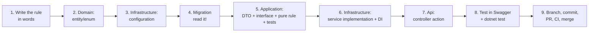

# PART 10 — How to Run and Maintain BloodFlow

[← Master guide](../../BLOODFLOW_COMPLETE_MASTER_GUIDE.md) · Short version: [`SETUP_GUIDE.md`](../../SETUP_GUIDE.md)

---

## 10.1 Install prerequisites
| Tool | Version | Check |
|---|---|---|
| .NET SDK | 10.0.100 or newer 10.0.x | `dotnet --version` |
| Visual Studio 2026 (18.x) + *ASP.NET and web development* | 18.0+ (VS 2022 isn't officially supported for .NET 10; the CLI works with any editor) | Help → About |
| SQL Server Express/Developer + SSMS | any recent | SSMS connects |
| Git | any | `git --version` |
| dotnet-ef | 10.x | `dotnet tool install --global dotnet-ef` → reopen terminal → `dotnet ef --version` |
| Postman (optional) | any | — |

## 10.2 Clone the repository
```powershell
cd $HOME\Desktop
git clone https://github.com/asmaa-mostafa25/BloodFlow.git BloodFlow-Main
cd BloodFlow-Main
```

## 10.3 Open the solution
Visual Studio → *Open a project or solution* → `BloodFlow.slnx`. Right-click **BloodFlow.Api** → *Set as Startup Project*. Build: `Ctrl+Shift+B` (or `dotnet build`).

## 10.4 Configure SQL Server
Find the server name in SSMS's connect dialog (e.g. `DESKTOP-MS535M4\SQLEXPRESS`) or in `services.msc` (`SQL Server (SQLEXPRESS)` → `.\SQLEXPRESS`; `(MSSQLSERVER)` → `.`). The service must be **Running**.

## 10.5 Secrets and environment
**Local (User Secrets)** — from `src\BloodFlow.Api`:
```powershell
dotnet user-secrets set "ConnectionStrings:DefaultConnection" "Server=YOUR_SERVER;Database=BloodFlowMain;Trusted_Connection=True;TrustServerCertificate=True"
dotnet user-secrets set "Jwt:Key" "<random ≥ 32 characters>"
dotnet user-secrets set "AdminSeed:Email" "admin@bloodflow.local"
dotnet user-secrets set "AdminSeed:Password" "<Upper+lower+digit, ≥ 8>"
dotnet user-secrets set "BloodFlowAi:ApiKey" "<only if you run the AI service>"
```
Generate a key: `[Convert]::ToBase64String((1..64 | ForEach-Object { Get-Random -Maximum 256 }))`.

**Server:** `src/BloodFlow.Api/appsettings.Production.json` (git-ignored), copied from `appsettings.Production.example.json`.
**Environment variables** also work (they override files): `ConnectionStrings__DefaultConnection`, `Jwt__Key` (double underscore = `:`). `ASPNETCORE_ENVIRONMENT` = `Development` locally (from `launchSettings.json`), `Production` on IIS by default.

> 🇪🇬 الأسرار (الباسوردات والمفاتيح) عمرها ماتتحط في Git. على جهازك في User Secrets، وعلى السيرفر في ملف متجاهل من Git.

## 10.6 Apply migrations
```powershell
dotnet ef database update --project src/BloodFlow.Infrastructure --startup-project src/BloodFlow.Api
```
Expect `Done.`. In SSMS: 20 tables, `__EFMigrationsHistory` has 6 rows.

## 10.7 Run
- Visual Studio: profile **https** → F5 → Swagger opens at `https://localhost:7244/swagger`.
- CLI: `dotnet run --project src/BloodFlow.Api` → `http://localhost:5034/swagger`.
- Tests: `dotnet test` → 83 passed.

## 10.8 Test endpoints
Swagger: login → copy token → **Authorize** → try endpoints. Full scenario: `API_DOCUMENTATION.md` §8. Also `src/BloodFlow.Api/BloodFlow.Api.http` and Postman (Part 7 §7.13).

## 10.9 Troubleshooting
| Symptom | Cause | Fix |
|---|---|---|
| `dotnet-ef does not exist` | tool not installed | install, reopen terminal |
| `dotnet-user-secret does not exist` | typo | `user-secrets` |
| `SqlException: server was not found` | wrong server name / service stopped | exact SSMS name; start service |
| `SqlException: Login failed for user` (18456) | wrong DB user/password | fix secret; restart app |
| `Jwt settings are missing` | no `Jwt:Key` | set it |
| `AdminSeed:Email and AdminSeed:Password must be set` | missing | set both |
| `Failed to create admin user: Passwords must ...` | weak admin password | stronger password |
| Login returns 500 right after changing `Jwt:Key` | key too short for HMAC-SHA256 | use ≥ 32 characters |
| Every endpoint 401 | no/expired token | login again, Authorize |
| 403 `Auth.AccountPending` | not approved | approve as admin |
| CORS error in browser only | origin not allowed | add exact URL to `Cors:AllowedOrigins` |
| IIS `HTTP Error 500.30` | app crashed at startup | enable `stdoutLogEnabled` in `web.config`, create `logs` folder, read the log |
| `404` on `/` | API has no home page | use `/swagger` |
| Merge `CONFLICT` on `git pull` | both sides changed the same lines | resolve (`git checkout --theirs file` to take remote), `git add`, `git commit` |

**Method for any error:** type → key words → where does the value come from → find the detailed log.

---

## 10.10 Creating a new feature — the recipe

Every feature follows the same order. Use the **supervisor's request** (each hospital decides whether it allows emergency override) as your practice example. *This guide does not implement it — you will.*



1. **Write the rule in 3 lines:** endpoint, rule, tables. e.g. "Hospital has `AllowsEmergencyOverride` (default false). Admin can change it. `FulfilAsync` refuses an override if the destination hospital doesn't allow it."
2. **Domain:** add the property/entity in `src/BloodFlow.Domain/Entities/`.
3. **Configuration:** in `Persistence/Configurations/<Entity>Configuration.cs` set column type, defaults, indexes, CHECKs.
4. **Migration** (§10.12) — open the generated file and read every line.
5. **Application:** request/response DTOs with validation attributes; add the method to the interface; put pure decisions in a rules class and write unit tests.
6. **Infrastructure service:** implement: `TryGetCaller` → load → check rules → change → `_audit.Add(...)` → one `SaveChangesAsync` → return DTO/`Error`. Register new services in `DependencyInjection.cs`.
7. **Controller:** thin action with route, `[Authorize(Roles = ...)]`, `[ProducesResponseType]`, `.ToActionResult(this)`.
8. **Test:** `dotnet test`, then Swagger (happy path + each error code).
9. **Git** (§10.14).

## 10.11 Adding a new entity (step by step)
1. `src/BloodFlow.Domain/Entities/DonorProfile.cs` (example name from the DBML) — plain properties, navigations `= null!`.
2. `src/BloodFlow.Infrastructure/Persistence/Configurations/DonorProfileConfiguration.cs` — `internal class DonorProfileConfiguration : IEntityTypeConfiguration<DonorProfile>`; `HasKey`, `Property(...).HasMaxLength(...)`, enums `HasConversion<string>()`, FKs with `OnDelete(DeleteBehavior.Restrict)`, indexes, `ToTable(t => t.HasCheckConstraint(...))`.
3. `AppDbContext`: `public DbSet<DonorProfile> DonorProfiles { get; set; } = null!;` (configuration is picked up automatically).
4. Migration.

## 10.12 Creating a migration
```powershell
dotnet ef migrations add AddDonors --project src/BloodFlow.Infrastructure --startup-project src/BloodFlow.Api
# read src/BloodFlow.Infrastructure/Persistence/Migrations/<timestamp>_AddDonors.cs
dotnet ef database update --project src/BloodFlow.Infrastructure --startup-project src/BloodFlow.Api
```
Made a mistake **before** applying it anywhere shared? `dotnet ef migrations remove ...` (same `--project/--startup-project`). Already applied? Add a **new** migration that fixes it. Never edit an applied migration. For the server database use `--connection "<public server connection string>"`.

## 10.13 Adding a new endpoint
Example shape (do this in the right controller):
```csharp
/// <summary>What it does, who may call it.</summary>
[HttpGet("expiring")]
[ProducesResponseType<PagedResult<BatchDto>>(StatusCodes.Status200OK)]
public async Task<IActionResult> Expiring([FromQuery] BatchQuery query, CancellationToken cancellationToken) =>
    (await _inventory.GetBatchesAsync(query, cancellationToken)).ToActionResult(this);
```
Checklist: route unique; correct role; `CancellationToken` passed down; returns `Result` → `ToActionResult`; documented in `API_DOCUMENTATION.md`; a test for any new rule.

## 10.14 Committing and pushing
```powershell
git checkout master
git pull origin master
git checkout -b feature/hospital-override-policy
# ... work ...
git status                      # appsettings.Production.json must NOT be listed
git add .
git commit -m "Hospitals choose whether they allow emergency override"
git push -u origin feature/hospital-override-policy
```
Then on GitHub: **Compare & pull request** → wait for CI (green) → **Merge** → delete the branch. Locally: `git checkout master` and `git pull`.
Rules: one feature per branch; small commits with clear messages; never commit secrets; never push broken builds to `master`.

## 10.15 Deploying an update (MonsterASP)
1. If you added a migration: `dotnet ef database update ... --connection "Server=dbXXXX.public.databaseasp.net;..."` from your machine.
2. Visual Studio → right-click `BloodFlow.Api` → **Publish** (MonsterASP profile).
3. Check `https://bloodflow.runasp.net/api/lookups/blood-groups`.
4. If 500.30 → enable stdout log (§10.9), read, fix, publish, disable the log.
Full section: `README.md` → Deployment.
